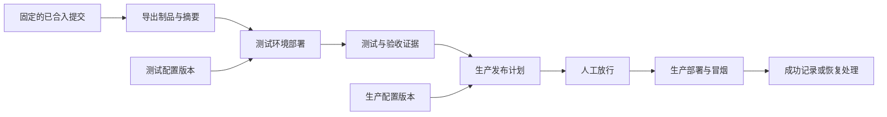
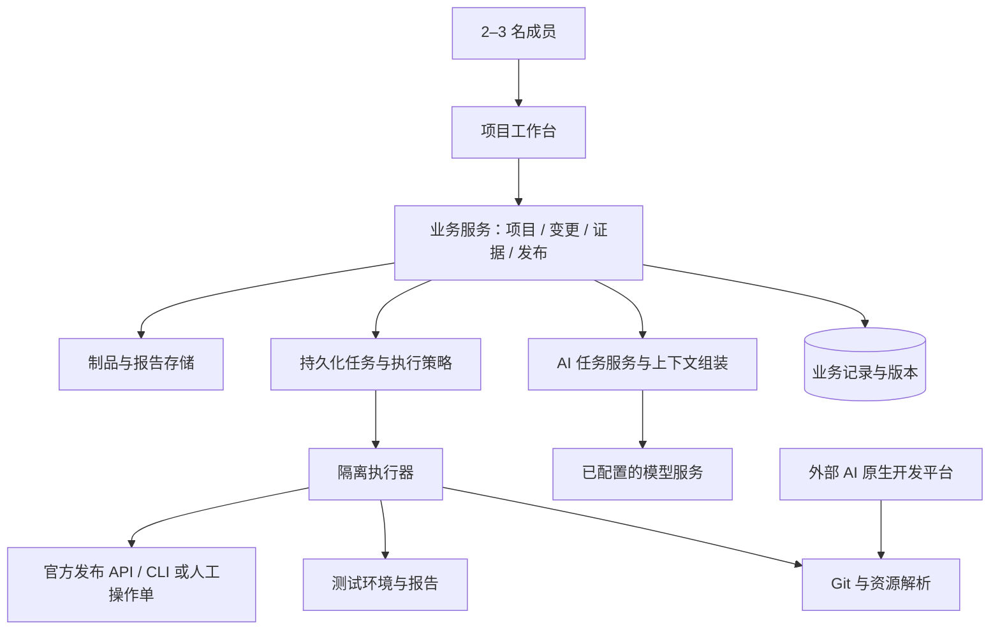

# AI 辅助 DevOps 平台设计方案

版本：v0.4｜日期：2026-10-02｜状态：加入 P0 技术实现规格，供产品与技术评审

适用对象：围绕 AI 原生开发平台开展交付的 2–3 人团队。首个适配对象为 Phoenix 资源型工程，以 [ikkyu-phx](https://gitee.com/kadbbz_admin/ikkyu-phx) 为样本。

本文中的 `[P26]` 为用户提供的《2026年十大技术趋势》PDF 第 5–6 页，`[U1]` 为用户补充的 Gartner 第 22 页截图，`[R1]`–`[R5]` 为固定提交的工程证据，详见[研究依据与引用台账](./研究依据与引用台账.md)。台账中的 G1–G4 仅保留为此前研究记录，不作为本版新增能力的依据。未特别注明为外部观点的部分，均为本方案的设计建议；排期和指标是试点假设。

本方案的具体 P0 实现基线另见[DevOps 平台 P0 技术规格](./DevOps平台P0技术规格.md)，包括 Docker Compose 拓扑、MySQL 与 Git 容器、named volume、TypeScript 全栈、React/Ant Design、RBAC 三员、全流程 AI agent、审计文件查询和技术栈变化可视化。本文保留产品取舍、研究映射和企业定制软件背景；两份文档不一致时，以 P0 技术规格的实现边界为准。

## 1. 推荐方案与关键取舍

建设一个**以项目为边界、以变更为工作单元的 AI 交付工作台**。人在平台内提出目标、确认方案、检查证据并放行发布；AI 负责澄清需求、准备设计与开发上下文、推荐测试、审查变更、总结失败和生成发布计划。实际开发继续在外部 AI 原生开发平台进行。

每项变更最终应回答五个问题：**为什么改、同意怎么改、实际改了什么、凭什么认为可用、哪个环境运行着哪个版本。** 所有功能围绕这些问题展开。

### 1.1 三种方向比较

| 方向 | 主要形态 | 成本与不足 | 判断 |
| --- | --- | --- | --- |
| A：仓库内的 AI 脚本与模板 | Git 文档、命令行检查、人工发布记录 | 起步最快，但项目状态、证据和环境分散 | 可作零阶段验证工具 |
| B：轻量项目工作台 + AI 助手 + 执行适配器 | 一个项目入口，连接外部开发、Git、测试和发布 | 需要少量集成；能够形成交付闭环 | **推荐** |
| C：一体化自主软件工厂 | 内置开发、可编排 agents、流水线设计器、环境编排 | 工具维护与权限复杂度高，容易变成另一个大平台 | 当前不采用 |

B 适合当前团队：保留已有开发方式，把截图列出的生命周期 AI 能力集中到一个项目入口，并把需求、测试、审查和发布证据串起来。附件 PDF 将 AI 原生开发平台与生成式 AI、精干团队和低风险试点联系起来；具体产品结构由团队约束决定。[P26]

### 1.2 第一版必须坚持的边界

- **项目统一入口**，项目内用一种“变更单”承载需求、缺陷与小型改进，不再增加需求单、任务单、测试单、审批单之间的层层流转。
- **先交付一个真实闭环**：一个项目、一套开发工具、一个 Git 提供方、一种发布路径；数据模型允许多个环境，首期验证 `test → prod`。
- **AI 输出直接附着到工作对象**，可应用、编辑、驳回和追溯来源。聊天是辅助入口，正式结论必须落成结构化记录。
- **状态由事件和证据驱动**。AI 可以建议状态变化，不能凭自然语言“已经完成”替代测试结果或发布结果。
- **高影响动作保留人工确认**。AI 生成建议、补丁、配置或事件处置草稿；测试、合并、生产发布和漏洞修复由人确认后执行。

第一版不做：内置 IDE、代码托管、自研模型训练、通用 agent 市场、可视化流程编排器、复杂组织/工时/绩效管理、独立测试管理系统、完整 CMDB、Kubernetes 管理平台、7×24 自动运维修复。

## 2. 已知事实、设计假设与待验证能力

### 2.1 示例工程对设计的直接影响

本次静态检查固定在提交 `e98da818f2a360e35381205039a4b913b79df8e7`，没有运行样例业务或其中的写入型测试。

| 已确认的事实 | 对本平台的要求 |
| --- | --- |
| `app.pxproj` 与 `documents/**/*.json`、metadata 构成主要工程资源 [R1] | 能识别页面、逻辑、权限、外部接口等业务资源，不能只按代码行解释差异 |
| `intent.md` 表达业务意图，`spec/` 明确为实现后的反推规格 [R2] | 导入时区分意图、目标设计与“当前实现说明”，不能自动将三者视为已批准基线 |
| `ask.metadata.json` 有 `$deps` [R4] | 可做候选依赖与影响分析；动态引用及不完整依赖需标成未知 |
| 25 个测试定义直接访问 ikkyu 后端 [R3] | 可以复用契约测试，但需要补 Phoenix 应用入口、权限传播与问答链路验证 |
| 业务前端尚未重建 [R2] | 不把已有系统页面或测试通过误判为完整业务已交付 |
| 环境相关配置含知识库地址/令牌与模型地址/令牌/模型名 [R2] | 同一应用制品与环境配置分离；模型配置变化也应触发相应回归 |
| 仓库包含数据库及服务端数据文件，缺少已确认的发布契约 [R1]、[R5] | 制品范围必须先确认；禁止将整个仓库直接覆盖到生产 |

### 2.2 当前采用的假设

这些假设用于形成可实施方案，不表示现有平台已经支持。

1. 团队内部使用，成员互相信任但仍需保留操作记录；不建设面向客户的多租户 SaaS。
2. 首期每个项目绑定一个主仓库，后续有实际多仓需求再扩展。
3. 团队沿用现有 AI 开发平台与 Git 托管；平台自身的业务页面优先复用熟悉的 AI 原生平台。
4. 先配置测试、生产两类发布目标；本地/开发环境允许只登记链接，预发布环境按实际需要增加，不强制四套环境。
5. 暂无已确认的持续集成和发布工具，因此“人工操作并留证”是正式集成模式，自动执行需完成能力验证后启用。

### 2.3 开发前必须解决的五个问题

| 问题 | 验证方式 | 不满足时的处理 |
| --- | --- | --- |
| Phoenix 如何生成可追溯的发布包？ | 用干净提交做一次官方导出，检查依赖与运行时版本 | 先登记官方手工导出包及摘要；不虚构构建命令 |
| 能否导入、发布、查询目标版本及回滚？ | 在测试环境走通一次发布和恢复 | 平台生成操作单，人用官方工具执行并回传；界面显示“人工执行” |
| 环境变量、数据库结构与数据如何分离？ | 验证配置覆盖、迁移与备份机制 | 将受影响发布列为人工处理，未演练的破坏性迁移不进入生产 |
| 可否以真实用户身份调用 Phoenix 业务入口？ | 用两个角色验证允许/拒绝行为 | 首期人工验收或官方 UI 自动化；不编造 HTTP 接口 |
| 业务工作台是否支持版本持久化、成员校验和可靠任务对接？ | 做一个变更版本、一个异步任务和一次幂等回调实验 | 管理面改用独立轻量 Web 单体，保持业务与适配器契约不变 |

这些问题不阻止需求、设计和证据工作台先行落地，但会影响自动发布的实现承诺。[R5]

## 3. 方法论：按附件和截图落实 AI 原生开发平台

### 3.1 可直接引用的材料结论

附件 PDF 第 5 页把 AI 原生开发平台描述为使用生成式 AI 加速软件开发的多种平台形态，并强调由 AI 智能体与员工协同的精干团队；第 6 页给出五项落地行动：建立平台团队、落实安全防护机制、试点 AI 原生开发、采用 AI 优先思维、提升团队能力。[P26]

这些页面支持本方案采用“2–3 人团队 + 外部 AI 开发平台 + 低风险真实项目试点”的方向，但不支持把某个具体产品、数据模型或自动化程度写成 Gartner 要求。你提供的第 22 页截图进一步列出生命周期能力，本文用 `[U1]` 单独标注；它不是附件 PDF 的页面，不与 PDF 页码混用。

### 3.2 本方案定义的交付闭环


这是本方案的工作流，不是 Gartner 命名的方法论。可复核的输入、输出和证据是贯穿各环节的设计原则。

### 3.3 截图能力覆盖审计

这里的“覆盖”指团队能在项目中使用截图列出的能力，并能回到具体变更、提交、测试或发布记录；不表示 Gartner 已验收本方案，也不把建议功能写成现成能力。

| 生命周期位置 | `[U1]` 明确列出的能力 | 本方案的使用方式 | 首期状态 |
| --- | --- | --- | --- |
| 计划 | 提升用户故事的质量、生成测试用例、自动化威胁建模 | AI 将简述整理为用户故事、验收标准、测试草稿和威胁清单；负责人确认范围、风险和验收 | 用户故事/测试草稿 P0；威胁建模 P1 |
| 开发 | 解释、重构、审查、调试、创建 API 定义和文档 | 外部 AI 开发平台处理实际资源；工作台传递已确认上下文并回收提交/PR | P0，人工提交和审查 |
| 测试 | 从代码生成测试、测试影响分析、自动修复漏洞、用于负载测试的合成数据 | AI 生成测试补丁并标出受影响用例；漏洞修复只生成候选补丁；合成数据只进入隔离负载测试 | 测试生成/影响分析 P0；其余 P1 |
| 发布 | 变更影响分析 | 以候选提交与目标环境当前版本做完整差异，提示未关联改动和受影响配置 | P0 |
| 配置 | 生成配置模板和运行手册 | 根据候选版本和环境差异生成可审阅模板、发布步骤和恢复步骤 | P0，人工确认后使用 |
| 监视器 | 根本原因分析和自动化事件响应 | AI 读取脱敏事件与版本记录，生成原因假设和响应草稿；只允许低风险、可回退动作进入自动化 | P1 |

### 3.4 范围边界

平台只为上述能力提供项目上下文、外部开发交接、证据关联和人工确认，不建设内置 IDE、多智能体编排器、独立安全平台或完整运维平台。自动化威胁建模、漏洞修复和事件响应先以建议/草稿形式交付；只有在隔离环境验证后，才允许项目策略开启有限自动动作。

## 4. 产品结构：一个项目、一个变更工作台

### 4.1 信息架构

全局只有“项目列表”和个人待办。进入项目后提供四个主入口：

1. **概览**：当前目标、需要我决定的事项、进行中的变更、各环境当前版本。状态卡都能回到原始证据。
2. **变更**：收件箱/看板与变更详情，承载需求、缺陷和改进。
3. **发布与环境**：候选版本、配置差异、发布历史、测试结果、回滚入口。
4. **项目设置**：仓库、成员、应用入口、规则、模型策略、环境和适配器连接。

项目资料作为概览中的可展开区域，保存业务背景、术语、架构约束和规格来源；第一版不另做知识库产品。测试和审查是变更/发布中的视图，不设第二套工单。

### 4.2 变更详情的阅读顺序

```text
知识库项目 / CHG-001 资源访问控制改进
状态：待验收    负责人：成员 A    目标：下一个版本

下一步：成员 B 检查 AC-03 的应用入口权限证据
原因：现有测试只覆盖后端 API，尚缺 Phoenix 用户角色验证

目标与验收 | 方案 | 开发关联 | 测试与审查
-------------------------------------------------
当前页正文 / 版本差异 / 证据链接
右侧 AI 助手：检查缺口、解释风险、生成下一步材料
底部时间线：确认、提交、测试、审查、发布
```

这是交互草图，姓名、编号和场景仅作演示。首屏优先显示“现在要做什么、为什么”，不展示 token、提示词版本等实现细节；这些信息放在“运行详情”中。

### 4.3 AI 结果的交互要求

- 每份建议标明依据、待确认项和生成时使用的版本。
- 用户可以选择“应用到草稿”“编辑后应用”“忽略并说明原因”。更新已确认内容时必须产生新版本和差异。
- 证据不足显示“缺少信息”，模型不可将它改写成“通过”。
- 运行失败能查看脱敏错误、保留已有草稿并重试；用户可继续手工推进。
- 对“帮我上线”先生成明确的发布计划与检查结果，最终执行由环境策略和批准记录决定。

### 4.4 项目模板与项目初始化

项目模板是项目创建时可组合、可版本化的初始化包，不是固定流程，也不是通用模板市场。它让创建人快速带入项目配置、外部 AI 开发平台需要的项目上下文，以及已有团队的协作习惯。以下是本方案的产品设计建议，不是 Gartner 原文或 Gartner 对具体文件格式的规定。

**模板组件**按需勾选，不要求每个项目一次填完所有内容：

| 组件 | 示例内容 | 用途 |
| --- | --- | --- |
| 项目基线 | 项目目标、客户/业务域、应用类型、仓库、主分支、负责人 | 建立项目边界并关联交付事实 |
| 项目配置 | 环境名称、部署入口引用、配置占位符、NFR 清单、AI 使用策略 | 让验收和发布按项目实际情况工作；密钥只保存凭证引用 |
| AI 指令与 Skill | `AGENTS.md`、项目级 Skill，如需求澄清、审查、发布准备 | 提供项目上下文和任务指导，不赋予平台权限 |
| 工作区文件 | 术语表、架构约束、测试指南、业务流程和数据说明 | 减少外部开发平台每次重新收集背景的成本 |
| 协作约定 | PR 模板、提交约定、测试入口、发布/恢复运行手册 | 保留现有团队的代码审查和交付习惯 |
| 应用类型清单 | 管理软件的角色/流程；分析软件的数据契约/新鲜度；现场软件的离线/同步；供应链软件的幂等/一致性；客户服务软件的权限/审计 | 让需求、影响分析和测试提出相关问题，不为每种形态另建平台 |

模板可按目标开发平台生成其接受的路径和格式。例如：

```text
template/
├── template.yaml
├── AGENTS.md
├── .project/
│   ├── project.yaml
│   ├── environments.yaml
│   ├── nfr.yaml
│   └── ai-policy.yaml
├── .agents/skills/
│   ├── requirements/SKILL.md
│   ├── review/SKILL.md
│   └── release/SKILL.md
├── .workspace/
│   ├── glossary.md
│   ├── architecture.md
│   └── test-guide.md
├── .github/pull_request_template.md
└── docs/project-context.md
```

此目录仅为示意。不同外部 AI 开发平台对 `AGENTS.md`、Skill 和工作区文件的发现规则可能不同，平台通过轻量适配映射路径和格式；不兼容的组件应明确提示，不静默写入无效位置。规范文件名使用 `AGENTS.md`；已有 `AGENT.md` 可以导入为普通项目材料并提示用户确认，不自动视为生效指令。

**组装和应用**压缩为六步：

1. 选择基础模板：空白企业应用、管理/分析/现场/供应链/客户服务应用，或 Phoenix 资源型项目。首期只实现一个试点模板，其他类型提供可编辑清单。
2. 选择团队模式：新团队引导、现有团队接入或熟练团队快捷创建。
3. 勾选组件：项目配置、`AGENTS.md`、Skill、工作区文件、PR/测试/发布约定、NFR 和环境定义。
4. 填写项目变量：项目名、业务域、仓库、主分支、成员、应用类型、外部 AI 平台、Git/测试/发布入口。缺失但非必需的信息可稍后补齐。
5. 预览生成结果：文件树、变量渲染、将新增/合并/跳过的文件、冲突、敏感信息检查、工具连接和拟启用动作。
6. 确认应用：新项目生成初始文件；已有项目默认生成初始化分支或 PR，经正常审查后合入。实例化结果记录模板版本和确认人。

创建人也可以在组装页面选择“保存为团队模板”：平台把已确认的组件、变量定义、适配器映射和风险策略保存为草稿，去除密钥、令牌、客户生产数据和项目特有值后，再由项目成员发布为不可变版本。保存模板与应用模板使用同一套预览、敏感信息检查和审阅机制；没有确认的草稿不能被其他项目直接使用。

**新团队路径**默认采用引导模式：字段尽量少；逐项说明信息用途和影响；生成基础项目说明、术语表、`AGENTS.md`、少量可选 Skill；默认人工审查、人工生产发布；通过一项低风险变更熟悉流程。Skill 触发条件应具体且少量，先不要求团队编写复杂智能体配置。

**现有团队路径**先扫描仓库中的 `AGENTS.md`、Skill、工作区说明、PR 模板和测试入口，再以只读预览呈现识别结果。默认只补缺失内容；同路径文件采用“新增、合并、跳过”逐项处理，存在实质冲突时要求比较并由项目成员决定。保留现有分支、PR、测试和发布方式，不因接入模板强制迁移工具。

**熟练团队路径**支持最近使用模板、快捷创建和有限批量初始化；可以自动生成低风险草稿或在隔离测试环境执行已批准检查。熟练程度不能绕过生产发布、数据迁移、凭证授权和权限变更的确认。

模板误用控制：模板版本发布后不可变，更新产生新版本；项目实例记录模板版本、参数摘要、生成文件清单和冲突处理结果。模板更新不自动覆盖既有项目，只显示差异和升级建议。参数渲染前校验必填项、格式和路径；扫描密钥、令牌、生产数据等敏感内容；生产权限不能由模板授予。`AGENTS.md` 与 Skill 只能影响 AI 行为，平台仍独立校验工具权限和允许动作。对已有文件优先生成 diff/初始化 PR，支持 dry-run、撤销和失败后清理；应用不完整时保留草稿而不留下半成品。项目级 AI 指令和 Skill 的修改进入常规 PR 审查，平台说明指令层级冲突及最终生效规则。

## 5. 项目内的工作流与角色

### 5.1 一种轻量变更单

创建时只强制填写**标题、期望结果、负责人**。AI 从简述或粘贴材料补齐：背景、用户、范围/非范围、验收标准、风险和依赖。验收标准使用稳定编号，例如 `AC-01`，方便关联测试与审查。

类型仅分“需求、缺陷、改进”；优先级采用“现在、随后、以后”，需要时再增加截止日期。大型需求拆成能独立验收的变更，首期不引入 Epic、Sprint、故事点和多级子任务。

### 5.2 五个状态与独立的阻塞标记

| 状态 | 进入/离开依据 | AI 的作用 |
| --- | --- | --- |
| 收件箱 | 收到想法或问题；范围和验收尚未确认 | 检查歧义、找相似变更、形成草稿 |
| 就绪 | 人确认范围、验收和必要设计，冻结一个版本 | 生成开发包、建议检查项 |
| 开发中 | 负责人开始外部开发，关联分支或工作入口 | 整理影响范围、解释新发现 |
| 待验收 | 有可定位的提交/制品与开发说明 | 组织测试、审查、失败诊断与验收缺口 |
| 已完成 | 验收通过，达到该变更约定的交付目标 | 生成摘要与经验候选 |

任意未完成状态可标“阻塞 + 原因”，解除后保留原状态；取消/归档作为结束动作，不增加常用看板列。返工回到开发中并保留历史。

**完成与发布分开**：默认业务变更以生产发布成功并通过检查为交付目标；若约定只交付设计或测试环境验收，必须明示。一个发布可包含多个变更；变更完成也不抹去后续发布失败或回滚记录。

### 5.3 三个常用人工确认点

1. **准备开发前**：确认目标、验收标准和设计。小改动的设计可只有几行，与需求一次确认。
2. **进入可发布状态前**：核对验收标准、测试/审查证据和剩余风险。测试与审查可以并行，代码审查可直接发生在外部 Git PR。
3. **进入生产前**：确认具体制品、环境、配置差异和恢复办法。若验收与生产放行在同一页面完成，可以一次操作，但记录分别绑定对象与版本。

没有需求评审会、设计评审会和发布评审会的固定要求；需要讨论时再召开。测试环境发布可按项目策略自动执行。

### 5.4 两三个人如何分工

每个项目设置一名项目负责人；每项变更有一名交付负责人，另一位成员承担关键复核。第三位成员如存在，可侧重业务验收或测试。身份可兼任，不复制产品经理、架构师、QA、运维的组织岗位。

成员日常权限分“负责人、成员”；生产发布权单独授予。AI 不替代团队成员，也不拥有自动放行权。通常由另一位成员复核权限、数据和生产影响；紧急情况下允许有生产权的负责人自批，但必须记录理由和事后复核事项。

## 6. AI 应该做什么、产生什么

首期使用一个 AI 服务入口和挂在变更下的生命周期任务记录，不部署多个长期在线、互相对话的独立 agents。每项任务都回到同一个项目和变更。

| 环节 | AI 输入 | 主要输出 | 人负责的决定 |
| --- | --- | --- | --- |
| 计划 | 简述、项目背景、已有变更 | 用户故事、验收标准、测试用例草稿、威胁建模草稿 | 范围、优先级、风险和验收是否正确 |
| 开发 | 已确认目标、资源、接口、约束和基线提交 | 解释、重构、调试、审查建议、API 定义和文档草稿 | 是否采纳修改、提交和 PR 内容 |
| 测试 | 验收标准、代码/资源差异、现有测试 | 从代码生成测试、测试影响分析、漏洞修复候选补丁、负载测试合成数据 | 接受测试修改、漏洞修复和业务验收 |
| 发布 | 候选提交/制品、目标环境当前版本 | 变更影响分析、发布说明、发布前检查 | 是否允许进入目标环境 |
| 配置 | 环境差异、配置项名称、操作约束 | 配置模板和运行手册草稿 | 配置值、迁移步骤和恢复办法 |
| 监视器 | 脱敏日志、事件、版本与变更记录 | 根本原因分析、事件响应草稿 | 是否执行响应，是否允许有限自动动作 |

### 6.1 优先兑现的三个场景

**计划到开发包。** 将一句话需求变成用户故事、验收标准、测试用例和威胁建模草稿，再携带项目规范、相关资源与未知点交给外部开发平台。

**变更到影响与测试。** 将 Phoenix 资源差异解释为“改动了哪个逻辑、影响哪些调用者、权限是否变化、哪些验收缺证据”，同时生成测试补丁和测试影响范围，帮助非专职 QA 成员做有效复核。

**候选版本到可放行说明。** 自动汇总变更影响、配置模板、运行手册、本版做了什么、哪些测试真正跑过、哪些风险未解决、目标环境是否准备好，让人做一次有依据的判断。

### 6.2 AI 的运行契约

每次任务绑定项目、变更版本、输入提交/制品、任务模板版本和发起人。结果采用可校验结构：`summary`、`findings[]`、`evidenceRefs[]`、`unknowns[]`、`proposedActions[]`，另外可显示便于阅读的 Markdown。

每项发现至少包括“问题、位置、依据、影响、建议”；影响分析标明“已确认引用/推测关联”。只保存可展示的结论依据与工具调用记录，不依赖获取模型内部思维过程。

输出分为三层权限：

- **直接完成**：读取已授权上下文、总结、生成草稿、标出缺口。
- **受策略约束执行**：在隔离测试环境运行已登记测试、读取脱敏日志、生成测试环境发布预检。
- **人工确认后执行**：修改已确认基线、合并代码、改变生产配置、生产部署、数据库迁移或恢复。

漏洞修复、配置变更、合并、生产发布和事件响应由应用规则与人工确认校验；不把自然语言建议直接当作执行授权。

### 6.3 上下文、质量与费用

按“项目规则 → 已确认变更 → 当前提交相关资源 → 当前执行证据”组装上下文。引用同时包含路径/资源 ID、版本和摘要；先用目录、资源类型、依赖关系和全文检索，初期不引入向量数据库或知识图谱服务。

测试补丁先进入草稿/外部开发流程，不能由模型静默改写验收标准。AI 审查结论不能用“另一个 AI 说没问题”作证据；关键场景必须有可重复执行的检查或人工业务验证。

同一输入的结果可复用，但每个结果仍保留提交、测试、配置或事件证据。具体模型与费用待接入选型，不预设供应商价格。

## 7. 与外部开发平台和仓库的衔接

### 7.1 开发上下文包

首期支持复制 Markdown、下载文件和跳转到已配置的开发入口，同时将这个过程记录为生命周期任务。后续接标准 API 或 MCP 时，改为由适配器注入上下文并回收任务结果；不以特定 IDE 插件作为首期前提。

一个上下文包包含：

1. 变更 ID、需求/设计版本、基线提交、包生成时间和摘要指纹。
2. 目标、范围、验收标准与已确认设计。
3. 相关 Phoenix 资源及其候选依赖、现有接口与配置项名称。
4. 代码/资源命名约定、允许修改范围、数据与权限约束。
5. 测试入口、目标测试环境标识、回传所需证据、尚未确认事项。

不包含密钥、数据库内容、生产日志全文或整个仓库。外部开发需要的临时凭证由执行环境提供，不放进提示词。

### 7.2 开发回传

最小回传字段是“变更 ID + 仓库 + commit SHA + 说明”；有 PR 时附 PR URL，可附设计偏离说明、测试报告和发布包引用。人工填写和自动回调遵守同一契约。

回传只代表“开发交付已提交”，不会自动把变更标为完成。平台核实提交存在、与基线的关系及关联需求版本；若包生成后需求已更新，提示“上下文过期”，要求重新核对差异。

### 7.3 工程事实与管理事实各有一个来源

| 信息 | 权威来源 | 平台处理 |
| --- | --- | --- |
| 项目成员、变更目标、验收标准、已确认方案 | 工作台的版本记录 | 编辑产生版本；外部修改需明确导入与确认 |
| 实际代码、Phoenix 资源、测试实现 | Git 中的固定提交 | 读取、索引和比较，不在数据库中另维护一份可编辑代码 |
| 仓库中的 `intent.md`、反推 `spec/` | 对应 Git 提交 | 标注为导入背景/当前实现说明；不自动覆盖工作台目标设计 |
| 测试运行结果 | 具体执行记录及原始报告 | AI 只作解释，保留原报告链接与执行指纹 |
| 环境实际版本 | 发布目标查询或人工核验 | 存最近观测值与时间；未知/过期时明确显示 |

如果团队决定将工作台已确认规格同步回仓库，只产生待审查补丁，经外部开发正常提交；MVP 不做双向自动编辑同步。

### 7.4 Git 事件接入

Gitee 是首个提供方。先支持手工提交关联和主动同步；验证权限和 webhook 支持后再启用事件推送。PR、提交、构建事件统一成内部事件，附原始提供方 ID。

重复事件按提供方与事件 ID 去重；乱序事件以实际仓库状态为准；漏回调可主动刷新。webhook 的签名或鉴权方式以实际提供方契约为准，不能仅相信请求中的项目 ID。

## 8. Phoenix 工程专属适配

### 8.1 首期资源索引

识别 `app.pxproj`、业务文档、逻辑、页面、结构类型、权限、外部接口、全局变量名称及静态资源。以“资源类型 + 稳定 ID”为主要身份，路径作为显示与定位信息；若 ID 缺失或冲突，降级为路径并提示人工核对。

资源正文与 metadata 配对读取；使用 `$deps` 作为候选依赖，交叉核对正文引用。缺文件、悬空引用、未知 schema 或无法分析的表达式都要出现在覆盖说明中，不把“没有发现”写成“没有影响”。[R4]

### 8.2 面向业务语义的审查

第一版只提取高价值差异：

- 逻辑参数/返回值变化以及调用者可能不兼容。
- 执行权限变化、客户端可调用范围变化、鉴权方式变化。
- 外部接口地址表达式、请求/响应映射与错误处理变化。
- 服务端全局变量的新增、删除及引用变化；密钥值始终脱敏。
- 关键页面/逻辑依赖的新增、删除和重命名。

归一化只消除明确无语义的对象键顺序和格式变化；**不对流程节点、分支、规则等数组任意排序**。原始 diff 保留，AI 摘要可回到具体 JSON 路径。暂不实现完整 Phoenix 编译器或所有图形节点的语义解释。

### 8.3 制品和数据边界

用官方导出/构建结果作为应用制品，关联源提交、导出工具/运行时兼容信息和文件摘要；若只能人工导出，操作者声明来源，平台校验包摘要并标注“来源人工确认”。

`database/`、`server-data/`、WAL/SHM 文件及环境配置不默认视为可跨环境覆盖的应用资产。先确认哪些是设计资源、初始化资源、业务数据、运行状态；只按已确认契约打包与迁移。发布预检发现未分类数据文件时应阻塞相应自动发布，而非盲目排除官方必需文件。[R1]、[R5]

## 9. 测试与审查：按验收证据放行

### 9.1 四层验证，按变化选择

| 层次 | 验证内容 | 示例工程的起点 |
| --- | --- | --- |
| 资源静态检查 | JSON 可读、配对资源、关键引用、敏感配置、接口变化 | 新增轻量检查器，未知 schema 不假装通过 |
| 外部服务契约测试 | ikkyu API 返回、错误语义、异步任务 | 复用现有 25 个测试定义，需在授权测试服务上实际运行 |
| Phoenix 应用集成测试 | 用户身份、角色传递、业务逻辑、配置注入 | 尚需建立入口与夹具，不以契约测试替代 |
| 场景验收/AI 评估 | 权限拒绝、检索与问答、用户可见行为 | 建小型固定样例集，必要时人工验证 |

测试报告应包含所测系统、环境、提交/制品摘要、配置版本、测试套件版本、起止时间、通过/失败/跳过数量和原始报告。外部服务契约测试额外记录被测服务的可得版本信息；未知时明示。

现有测试有新增、删除和清理行为，且默认临时数据前缀并不等于强隔离。[R3] 自动执行仅允许登记的隔离测试目标，注入测试凭证，缺少目标配置时失败关闭；不得沿用代码中的默认服务或令牌。生产检查另用无破坏性的冒烟用例。

### 9.2 AI 功能的验证不能只看文字是否相同

以知识库问答为例，先由人确认一组小型评估样例：有权限且有答案、无权限、无命中、上游故障、恶意文档诱导等。检查角色隔离、依据引用、应答与拒答行为，不要求每次生成逐字一致。

模型评分可用于筛查明显问题，业务正确性由确定性断言或人工样例复核兜底。更换模型、提示词、检索规则或关键知识数据时，应重跑受影响样例，并记录这些输入的版本。

### 9.3 验收矩阵

每条 `AC-xx` 可关联自动测试、人工步骤或审查记录；显示“有证据、失败、缺证据、不适用”，不显示没有定义的综合质量分。

放行默认要求：

1. 必需验收条目均通过，跳过必须显式说明；本次提交仍与报告绑定对象一致。
2. 没有未解决的严重安全/数据/功能阻断问题。
3. 需求或设计偏离已经确认；AI 的猜测未被当作事实。
4. 必要的目标环境检查完成，恢复办法可执行。

在 PR 审查后新增提交、修改验收基线或更换制品时，受影响测试与审查标为过期。对代码差异的审查绑定 base/head SHA；生产候选默认来自合入后的固定提交，需重新确认最终差异并运行规定检查，不能自动沿用旧 PR 的绿色结果。

AI 建议不能直接豁免规则。非阻断项可由有权限成员写明理由后接受；跨项目权限、制品身份、目标环境身份、缺少必要批准等执行前提不能通过自然语言备注绕过。

## 10. 多环境发布与恢复

### 10.1 一个候选制品，多个环境部署记录

项目可配置 `dev`、`test`、`staging`、`prod`，首期只要求验证实际需要的环境。环境保存入口、执行方式、配置版本、凭证引用、负责人和最近观测到的应用版本。

**尽可能构建/导出一次，按同一摘要逐环境提升。** 如果 Phoenix 官方机制必须按环境重新生成包，则同时保留共同源提交、生成参数和每个包的摘要，并执行等价性检查；不能声称它们是同一个制品。



### 10.2 发布计划与确认指纹

一个发布版本可包含多个已验收变更。发布计划至少列出：源提交、制品摘要、目标环境、配置版本、包含变更、必需检查、迁移步骤、影响范围、旧版本与恢复办法。

发布范围以“目标环境当前源提交到候选提交”的完整差异为准，不能只勾选几张变更单就忽略实际包中的其他改动。差异中的未关联提交、未验收变更或共享资源变化必须纳入核对。首期采用短分支与小批量发布，不提供任意挑单拼包；确需挑选时，由外部开发产生独立候选提交并重新验证。

确认记录绑定上述计划的指纹以及所依据的验收/证据版本。制品、目标、配置、迁移计划或必需证据变化后批准失效；部署启动时再次核对。审批完成到执行之间若环境当前版本改变，应重新预检，避免覆盖他人的新版本。

### 10.3 固定发布流程

第一版采用固定步骤，不做拖拽式流水线：

1. **预检**：核对身份与权限、包摘要、兼容信息、目标状态、配置缺项、数据影响和恢复条件。
2. **锁定环境**：同一项目同一环境仅一个发布/回滚操作，生成唯一操作 ID。
3. **必要准备**：仅在存在数据变更时执行经确认的备份/迁移准备，不机械增加每次发布耗时。
4. **执行发布**：调用已登记的官方 API/CLI，或转交人工操作单。
5. **检查**：读取目标版本，运行适合该环境的健康检查和业务冒烟。
6. **记录结果**：成功需包含实际版本核验；失败、部分成功和未知状态分别记录，形成后续处理任务。

环境状态至少区分“待发布、执行中、待人工操作、验证中、成功、失败、状态未知”。人工模式只有回传版本/包证据并完成核验后才能成功，不把“已点击发布”当作成功。

### 10.4 失败与回滚

- **部署结果未知**：超时不等于失败。执行器先查远端操作/当前版本，避免重复导入或重复迁移；无法判定时保持环境锁定/待处置，不自动重试有副作用的步骤。
- **应用回滚**：选择已验证可用的旧制品和相容配置，走同一受控流程。自动回滚仅在该适配方式经过演练、应用状态可判定且无不兼容数据迁移时启用。
- **数据库变更**：应用回滚不等于数据回滚。首期优先向后兼容的扩展式迁移；删字段、重写数据等变更需要独立恢复计划和测试环境演练。
- **数据恢复**：恢复备份可能丢失备份后的写入，必须明确影响和人工决策；不能让 AI 根据报错直接恢复数据库。
- **配置与业务资源**：回滚需核对旧应用与当前模型/接口/权限配置兼容性；知识内容和用户数据通常独立管理，不能随应用包整体倒退。

## 11. 技术架构：管理面轻，执行边界清楚

### 11.1 推荐结构



这是职责划分图，不表示要部署每个框为独立服务。首期只要求一个管理应用、一个异步任务表和一个受限 runner；执行器需要权限隔离时单独运行，其他逻辑先保持在同一应用内。

### 11.2 选型原则与初步建议

**业务管理面优先复用团队的 AI 原生平台。** 项目、变更、成员、页面与普通业务逻辑适合用熟悉的 Phoenix 能力构建；前提是第 2.3 节的版本持久化、鉴权和回调实验通过。该选择来自团队学习成本，不是从样例仓库推断其具备全部平台能力。

**执行面采用薄 TypeScript worker 或受限 CLI。** 首期负责 Git 读取、资源解析、模型调用、隔离测试和人工发布回传；API 参数和结果做 schema 校验。只有在长任务、并发或权限隔离成为真实瓶颈时再拆成独立服务，工作台不维护第二套相互竞争的状态机。

若 Phoenix 管理面无法满足基本契约，备选为 TypeScript Web 单体（例如 Vue 3 + Fastify）及同一执行器。第一周实验后只保留一条实施路线，不同时开发两套 UI。

存储优先复用部署环境已有的可靠关系型数据库；独立实现时推荐 PostgreSQL，任务表先承担轻量队列。文件/报告使用持久卷或已有对象存储；无需为少量制品立刻自建制品仓库、Redis、消息总线、搜索集群和向量库。

部署规模初期为工作台、执行服务和所需数据库/存储。开发测试任务与生产执行权限隔离，可用不同 runner 身份/执行槽和环境专属凭证实现；不能将拥有生产密钥或宿主 Docker socket 的环境用于运行不可信 PR 测试。

### 11.3 最小数据模型

以下是逻辑实体，实施时可合并表或复用宿主平台实体；不预先建设通用工作流引擎。

| 实体 | 核心内容 |
| --- | --- |
| 项目 | 名称、目标、成员、主仓库、规范、资料来源、AI 策略 |
| 变更 | 类型、负责人、状态、阻塞、交付目标、用户故事、验收标准、适用的 NFR、当前需求/设计版本 |
| 内容版本 | 所属对象、类型、正文/结构化内容、父版本、指纹、确认人 |
| 执行记录 | AI/测试/同步/发布任务，输入版本、状态、结果、费用、证据附件 |
| 发现与处置 | 测试/审查发现、位置、严重度、状态、责任人、处理依据 |
| 应用/实例 | 应用类型、客户/业务域、部署实例、实例配置版本、环境与最近观测版本 |
| 环境 | 目标身份、入口、配置版本、密钥引用、策略、最近观测版本 |
| 发布版本 | 源提交、制品引用/摘要、变更集合、验收证据与恢复计划 |
| 部署记录 | 发布版本、目标环境、操作 ID、批准指纹、阶段、实际结果 |
| 项目模板 | 名称、不可变版本、应用类型、来源、组件清单、变量定义、支持的适配器、风险策略、状态 |
| 模板实例 | 项目、模板版本、参数摘要、生成文件清单、冲突处理结果、应用方式、初始化 PR/提交、确认人 |

成员关联、验收证据关联、批准记录与审计事件按需要作为关系表/附属记录。全部记录带项目边界；不允许用其他项目的报告“证明”当前项目通过。

### 11.4 关键内部契约

内部统一定义能力，而不假定外部工具已经存在同名接口：

- 仓库适配：解析固定提交、比较差异、读取资源、获取外部事件。
- 开发交接：导出上下文包、接收开发关联与说明。
- 测试适配：执行已登记测试入口，返回结构化结果与报告引用。
- 发布适配：预检、部署、查询操作、观测版本、恢复；每项能力注明“自动/人工/不支持”。

每次执行至少有 `projectId`、`operationId`、输入指纹和明确目标。第一版只实现所选工具的一套适配，不建设插件商店或多云抽象。

### 11.5 可靠性、可维护性和访问控制

执行器持久化任务状态，使用租约、心跳与超时回收；只对已确认幂等的动作自动重试。应用重启后从任务记录恢复，凭远端操作 ID 对账。手工上传的测试报告标记“人工提供”，与执行器产生的证据区分。

仓库内容、日志、网页、知识片段均是不可信输入，不能替代工具规则。模型只可调用结构化允许动作，不能将自由文本拼成任意 shell 命令。项目路径、目标地址与报告引用需校验授权范围，防止跨项目访问和任意网络访问。

密钥使用环境注入或现有密钥存储，业务库只保存引用；日志脱敏，导出包不携带令牌。记录发起人、批准人、执行身份、输入/输出摘要和结果，审计事件只追加；日常备份数据库及附件，并验证恢复。日志默认保留期建议 30 天，已发布制品/报告建议 90 天，试点按存储成本和追溯需要调整。

模型服务不可用时，需求编辑、人工验收、查看证据和按规则发布应继续可用。AI 是加速能力，不应成为整个交付流程的单点阻塞。

## 12. 用 ikkyu-phx 演示一次交付

**演示需求**：“员工只能检索自己有权限的知识，并在无权访问时获得明确提示。”这是用于验证平台设计的示例，不代表已经确认当前项目存在缺陷。

1. **导入项目**：读取 `intent.md`、反推规格、资源索引和测试清单，形成“当前实现概览”。AI 提醒测试当前直连后端，业务前端尚未完成。[R1]、[R2]、[R3]
2. **形成验收**：AC-01 有权用户可检索；AC-02 无权用户不可获取受限资源；AC-03 通过 Phoenix 真实身份调用也有效；AC-04 无命中和后端故障有可区分表现。具体预期由业务负责人确认。
3. **形成设计**：定位 `KB_GetAvailableDomains`、`KB-RetrieveKnowledgeWithPermission`、`ask` 与权限资源；检查领域、资源标签和当前用户角色传播。提出可能影响但不宣称静态图覆盖全部路径。
4. **外部开发**：成员 A 将确认后的上下文包交给现有开发平台；完成后关联提交，说明实际变动与测试。
5. **测试与审查**：在隔离环境复用契约测试；另通过 Phoenix 入口验证两个测试角色；AI 对照 AC-01–04 汇总证据，成员 B 复核权限与失败路径。
6. **准备发布**：从最终提交得到官方制品，测试环境验证后保持制品身份；核对生产知识库/模型配置引用和恢复办法。
7. **生产与反馈**：有权限成员放行，执行无破坏性冒烟，记录实际版本；发布失败时按已演练流程处置。遗漏场景形成新的变更，而不是在聊天记录里消失。

场景中的关键价值是：AI 不只是生成实现建议，还能指出“已有 25 个测试定义并不能证明 AC-03 成立”，把团队注意力引到真正缺失的证据上。

## 13. MVP 范围、排期与验收

### 13.1 首期功能边界

**P0：一个应用形态的可追溯闭环。** 项目、客户/业务域、应用类型、部署实例与环境；单仓关联；变更中的用户故事、验收标准和适用 NFR；外部开发上下文及 PR/提交关联；AI 代码审查建议、测试用例生成和测试影响分析；发布差异、配置模板、运行手册；人工 UAT/冒烟、发布记录、基础访问控制、密钥排除和操作审计。另包括基础项目模板、组件勾选、参数化渲染、已知目标文件的文件树预览和冲突检查、新项目生成、已有项目初始化 PR、新团队/现有团队初始化模式、组装结果去敏后保存为团队模板并经审阅发布，以及模板版本和实例化快照。AI 输出和发布证据均绑定应用、客户实例、提交与配置版本。

**P1：按实际应用形态扩展。** 模板扫描导入、更多外部 AI 平台路径适配、应用类型模板扩展、模板升级建议与差异影响分析；威胁建模、API/事件/数据契约分析、数据新鲜度和血缘提示、现场离线/同步检查、供应链幂等与一致性检查、客服角色与审计场景、合成负载数据、RCA、可靠测试/发布适配和更多 Phoenix 资源语义解析。AI 解释、重构、调试、API 定义和文档优先使用外部开发平台，工作台只关联其结果，不重复建设工具。

**P2：高风险或高维护成本能力。** 模板市场、跨组织共享模板、自动升级多个既有项目、模板驱动的生产权限变更，以及自动应用漏洞修复、自动事件响应、自动生产发布、多智能体编排、多仓库协同、跨应用通用知识图谱和自建 AI 安全平台。只有经隔离演练、明确回退和可观测性验证后再评估。

**明确不做：** 内置 IDE、代码托管、自研模型、通用 agent 市场、自定义流程设计器、独立测试管理系统、完整 CMDB、Kubernetes 管理平台、7×24 无人值守运维修复。模板能力保留在项目初始化和版本化配置范围内，不扩展为通用模板市场。

### 13.2 条件性实施计划

以 2–3 人团队在 4–6 周内完成一个应用形态的试点为目标，不预先承诺总人周；这不是 Gartner 数据，也不包含未知平台接口的长期研发。企业项目若涉及客户隔离、复杂数据迁移或现场网络限制，应单独评估，不能挤入通用试点期限。

| 阶段 | 建议时间 | 可评审产物与退出条件 |
| --- | --- | --- |
| 0：能力验证 | 第 1 周 | 确认管理面与外部开发平台；选定一个真实应用类型和客户实例；验证导出、版本核验、角色权限和测试隔离；确认模板目标目录与文件冲突策略；无法自动发布时确定人工留证方式 |
| 1：需求到 PR | 第 2–3 周 | 基础模板和项目初始化、项目/实例信息、用户故事/验收/NFR、外部开发上下文、PR 关联、AI 审查和测试影响分析；试跑一项小变更 |
| 2：PR 到生产 | 第 4–6 周 | 测试证据、配置模板、运行手册、UAT/冒烟、人工发布记录、实际版本核验和一次恢复演练；结束后评估是否值得扩展 |

成员 A 负责项目工作流与界面；成员 B 负责仓库、执行器与发布接入；第三人如有，负责真实场景验收和试点指标。需求与质量标准共同维护，避免把所有 AI 判断都交给同一位实施者确认。

### 13.3 上线试点的验收清单

- 一项真实需求能从简述走到生产部署记录，能逐步回溯需求版本、源提交、制品、测试证据与批准。
- 没有自动发布接口时，平台明确显示人工模式；人工回传缺少版本核验时不能冒充成功。
- 新提交、验收变化或配置变化会使相关证据/批准过期，旧绿色结果不能静默沿用。
- 重复回调不重复部署；任务超时可对账；两个成员同时发布同一环境时只有一个操作进入执行。
- 测试任务拿不到生产凭证；模型收到恶意仓库文本也不能越过允许动作和项目权限。
- 至少完成一次旧应用版本恢复演练，并明确它与数据恢复的区别。
- 模型不可用或预算用尽时，团队仍能编辑、验收和按规则交付。
- 模板初始化可预览和撤销；已有同名文件不会被静默覆盖，模板更新不会自动改写既有项目；模板不能授予生产权限或写入密钥。
- 用两个不同角色验证样例业务权限；已覆盖、未覆盖和人工验证内容可以分别查看。
- 计划、开发、测试、发布、配置、监视器六个位置均能查看对应 AI 输出及其证据来源；P1 能力明确显示为建议或人工确认状态。

### 13.4 衡量轻量与价值

先记录一周基线，再用 5–10 项规模相近的真实变更试点。样本很小时展示每项明细与中位数，不宣称统计显著，也不把任务数量增长自动归因于 AI。

| 指标 | 记录口径 | 用途 |
| --- | --- | --- |
| 人工协调耗时 | 每项变更在澄清、交接、整理测试/发布材料上花费的分钟数 | 验证平台是否真正减少重复工作 |
| 交付时长 | 需求确认到约定交付目标达成，保留阻塞时间 | 判断整体流程是否更顺畅 |
| 返工与遗漏 | 因需求歧义、审查遗漏、环境问题产生的返工次数和原因 | 防止只追求生成速度 |
| 发布质量 | 发布数、失败数、回滚数及故障恢复时间，标明样本量 | 审视自动化是否可靠 |
| AI 净成本 | 模型/执行费用 + 人工核验及维护时间 | 决定是否扩展某类 AI 能力 |
| 可追溯性 | 可回溯到完整版本与证据的试点发布比例 | 检查核心闭环是否落实 |

试点成功标准建议：关键发布记录全部可追溯；人工整理耗时呈下降趋势；没有因自动化扩大权限或破坏数据；成员愿意持续使用。具体提效百分比在获得基线后确定，不预先承诺“提升数倍”。

## 14. 企业定制软件背景下的轻重评估

本节是结合管理软件、数据分析软件、现场软件、供应链软件和客户服务软件背景做的工程判断，不是 Gartner 原文。判断标准是：AI 能力可以通用，但企业定制软件的交付约束必须被记录、验证和追溯。

### 14.1 当前做得偏轻的地方

| 方面 | 当前不足 | 调整建议 | 首期处理 |
| --- | --- | --- | --- |
| 交付对象 | 只有“项目 + 变更”，无法表达同一应用的客户、部署实例和版本差异 | 在项目设置增加客户/业务域、应用、部署实例、应用类型四个轻量维度；不新增 Epic 或多级工单 | P0 数据字段 |
| 非功能要求 | 验收主要是功能和权限，缺少性能、可用性、审计、恢复、离线等约束 | 变更中增加按应用类型选择的 NFR 清单，不另建测试工单 | P0 模板 |
| 集成与数据 | Phoenix 资源影响分析不足以覆盖 API、事件、ETL、数据契约、迁移和外部系统 | 影响分析至少分应用资源、接口/事件、数据结构、配置四类；未知依赖必须显式显示 | P0 记录和人工核对 |
| 客户化发布 | 只有 `test → prod`，没有客户配置、版本兼容和 UAT 记录 | 发布版本绑定部署实例、配置版本和验收对象；需要时增加 UAT，不强制所有项目四套环境 | P0 数据模型，按项目启用 |
| 发布后运行 | RCA 和事件响应目前偏 P1，企业系统容易出现“发布成功但业务不可用” | 至少记录健康检查、关键业务冒烟、告警、事件和运行手册；自动响应仍需后置 | P0 人工留证，P1 自动分析 |
| 安全与合规 | 只有 AI 输入不放密钥的约定，企业项目还需要访问、数据和审计边界 | 平台自身先有成员权限、敏感数据分类、模型出站规则和操作审计；SSO、客户数据隔离按项目要求接入，不把多租户做成 P0 | P0 基线，SSO/客户隔离按需 |
| 项目初始化 | 仅选择“小团队”流程模板，不能把项目级配置、AI 指令和既有协作约定可靠地带入新项目 | 支持组装项目配置、`AGENTS.md`、Skill、工作区文件、PR/测试/发布约定；预览差异并按新建/合并/跳过处理冲突 | P0 基础模板与实例化记录 |
| 应用类型差异 | 目前以 Phoenix 知识库为中心，不能直接覆盖不同软件形态 | 用应用类型清单表达差异：管理/客服关注角色与流程；分析关注数据契约与新鲜度；现场关注离线与同步；供应链关注幂等与一致性 | P0 支持一个试点模板；P1 扩展其他类型 |

应用类型模板不等于为每类软件建设一套平台。它只规定需求、影响分析、测试和发布时需要询问哪些问题。

### 14.2 当前做得偏重的地方

| 方面 | 当前负担 | 调整建议 |
| --- | --- | --- |
| P0 能力面 | 把六类 AI 能力、Phoenix 语义分析、执行器、发布、证据和指标同时放入首期，2–3 人难以交付 | P0 只打通三条高频路径：用户故事/验收、PR 审查/测试影响、候选版本/配置运行手册；其余能力保留统一入口和结果格式，按项目启用 |
| 开发工具建设 | 方案容易被理解为要自建解释、重构、调试、API 文档工具 | 这些能力由外部 AI 原生开发平台提供；工作台只负责上下文、提交、PR 和证据回流 |
| 技术拆分 | 独立 AI 服务、执行服务、任务租约、隔离 runner、存储和适配器一起建设，首期运维成本偏高 | 先用一个管理应用、一个异步任务表、一个受限 runner 和人工发布适配；长任务或权限隔离确有需要时再拆服务 |
| 多形态支持 | 同时为管理、分析、现场、供应链、客服实现完整适配，会把试点变成行业平台 | 首期只选一种真实应用形态；其他形态先交付模板和差异清单，不承诺自动化覆盖 |
| 模板扩展 | 一开始做模板市场、复杂继承、自动升级和多开发平台格式，会把初始化功能变成新的平台产品 | P0 只做少量组件、一个试点基础模板和清晰的 create/merge/skip；模板市场和跨项目自动升级暂缓 |
| 自动动作 | 自动修复漏洞、自动事件响应和自动发布容易把风险带入生产 | 首期只生成建议和操作单；自动动作必须有可回退、可观测、可演练的专项证据 |
| 交付承诺 | 4–6 周同时实现全生命周期能力，对企业定制软件偏乐观 | 将 4–6 周改为“完成一个应用形态的闭环试点”；跨形态和自动化扩展按试点数据另排期 |

### 14.3 建议的实际优先级

**P0：一个应用形态的可追溯闭环。** 项目模板组装与安全初始化；项目/客户实例/环境维度；用户故事、验收和 NFR；外部 AI 开发上下文；PR 审查、测试生成与影响分析；发布变更影响；配置模板和运行手册；人工 test/prod 发布；基础安全、审计和运行健康记录。

**P1：企业差异能力。** 模板扫描导入、多平台文件映射、模板升级影响分析和多种应用类型模板；威胁建模、API/事件/数据契约分析、数据新鲜度和血缘提示、客户配置矩阵、合成负载数据、RCA、可靠测试/发布适配。

**P2：高风险或高维护成本能力。** 通用模板市场、跨组织共享模板、自动升级已有项目、模板自动授予生产权限；自动应用漏洞修复、自动事件响应、自动生产发布、多智能体编排、多仓库协同和跨应用通用知识图谱。

这样既覆盖截图要求的生命周期位置，也不会把“平台支持某项 AI 建议”误写成“平台已经能安全自动执行该动作”。

## 15. 首次评审需要拍板的事项

本方案建议先同意产品边界，再通过短实验确定集成细节。首次评审聚焦以下五项即可：

1. 是否以“一个变更工作台”整合需求、设计、测试和审查，并保留外部开发。
2. 首个项目是否使用 ikkyu-phx，先选择哪个可独立验收的小变更试点。
3. 团队实际需要哪两个首期环境、由谁提供官方发布与版本查询方式。
4. 管理面优先复用 Phoenix 是否符合团队意愿；能力验证不通过时是否采用独立单体备选。
5. 源码和业务资料可以发往哪些模型服务，以及试点的费用上限和实际人员投入。

在这些选择明确前，可以评审工作流、实体和验收规则；自动发布的具体 API、Phoenix 包格式、运行环境和模型供应商保留为待验证项，不以猜测填充实现契约。

[P26]: ./研究依据与引用台账.md#p26
[U1]: ./研究依据与引用台账.md#u1
[R1]: ./研究依据与引用台账.md#r1
[R2]: ./研究依据与引用台账.md#r2
[R3]: ./研究依据与引用台账.md#r3
[R4]: ./研究依据与引用台账.md#r4
[R5]: ./研究依据与引用台账.md#r5
