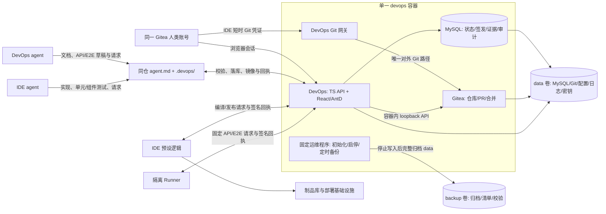

# AI 原生 DevOps 规格

版本：1.1（设计与验收基线；单容器与双卷运维）
日期：2026-10-06（Asia/Shanghai）
状态：**实现进行中。本文仍为目标验收基线；当前实现与未完成项见 [实现范围](implementation.md)，运行结果见 [验证记录](../test_case/verification.md)。**

本规格依据 [AI 原生软件工程轻量方法论](../prd/AI原生DevOps轻量方法论.md)，并纳入三个确定的产品约束：DevOps agent 与 IDE agent 共享一个项目 Git 工作区，通过根目录 `agent.md` 和专用目录协作；人类在 IDE 与 DevOps 使用同一 Gitea 账号；**DevOps 是 Git 的唯一操作入口**，包括读取、推送、创建分支、创建 PR 和合并。技术栈固定为 TypeScript、React、Ant Design、MySQL、Gitea，部署交付一个包含 DevOps、MySQL、Gitea 和进程管理/备份工具的 Docker 镜像；Compose 只有 `devops` 一个服务、一个容器，挂载 `data:/data` 与 `backup:/backup` 两个 named volume，一次启动自动完成初始化。

此规格替代旧 P0 功能、接口、数据表、导航和业务流程。旧数据无需迁移，也不保留兼容层；方法论文档是原则来源，本文是新产品的可实现契约。既有文档只作背景，不构成第二套实现基线。

## 1. 目标、边界与成功标准

面向 2–3 人、单仓或少量仓项目，提供“**目标与方案 → 确认工作区 → 开发与验收 → PR 与组合验证 → 发布签发 → 实际结果**”的完整控制面。日常操作以 intent 为单位；人类在一个界面判断下一步、审阅真实 Git 差异和证据、签发 Gate A/B/C、合并 PR 及处理未知结果。Agent 生成草稿和执行建议，不能写权威批准。

首期成功应可由外部观察：

1. 使用同一人类账号登录 DevOps，并在 IDE 配置该账号的短时 Git 凭证；IDE 的 `origin` 只指向 DevOps Git 网关。
2. DevOps agent 与 IDE agent 在同一个项目仓库读 `agent.md`，通过 `.devops/` 文件交接；每条请求有身份、操作 ID、版本和回执。
3. 一个 intent 经过 Gate A、受控代码提交、可复核构建/API/E2E、Gate B 自动建真实 Gitea PR、人类在 DevOps 内合并、组合提交重验、Gate C、IDE 受控发布和实际版本对账后关闭。
4. 未经 DevOps 的 Git 分支/合并路径不可到达；直接推目标分支、伪造通过文件、旧批准继续使用、未知结果盲重试均被阻断并审计。
5. 热修复从实际生产 `prod_sha` 起步，发布后同步回功能线；生产发布失败、结果未知和组合验证失败有可操作恢复路径。
6. 一个 Docker 容器和 `data`/`backup` 两个 named volume 即可启动，自动初始化内部依赖/账号、生成首备，默认每天自动全量备份；重建容器后数据完整，恢复后不会重放旧交付操作。

不做内置 IDE、第二个开发 agent、自动合并、DevOps 直接编译/部署、基础设施凭证托管、多智能体编排器、多仓依赖图和无人值守高风险发布。DevOps 可以调用 Gitea 与配置的 AI 服务，**不能调用部署/基础设施 API，也不能读取生产发布密钥**。IDE 预设逻辑及隔离 Runner 是外部执行者，不在这个一体化容器中执行用户项目的构建、API/E2E 或部署。容器自身的初始化、数据库启停、备份和恢复由固定运维程序负责；它们不属于应用发布能力，也不开放给 agent。

## 2. 系统边界与信任根



| 主体 | 唯一职责 | 明确禁止 |
| --- | --- | --- |
| DevOps 预设逻辑 | 方案校验、快照、权限/状态机、指纹、Git 网关/分支/PR/合并、证据与审计 | 源码开发、编译、制品生成、部署、基础设施访问 |
| DevOps agent | 点/应用/系统方案草稿；说明书、变更说明、接口契约、API/E2E 用例与验收解释 | 签发、批准自己输出、改权威状态、改应用实现、直接 Git 分支/合并、发布 |
| IDE 预设逻辑 | 固定构建和依赖、制品签名与来源/SBOM、部署、健康检查、回滚和实际结果 | 自行更改方案、代替人签发、用不同制品发布 |
| IDE agent | 在已确认分支实施代码/单元与组件测试，向 IDE 预设逻辑提编译和发布请求，准备同步 | 修改已签发目标或 DevOps 权威文档/API/E2E、直接调用基础设施、签发 |
| 人类 | 提出/确认目标、审证据、Gate A/B/C、在 DevOps 中合并、处理例外 | 用 AI 自述替代执行证据，修改签发对象后沿用旧批准 |
| 隔离 Runner | 读取固定 SHA 和命令 ID，准备/清理测试数据并执行 API/E2E | 任意 shell、部署、签发、改变策略 |

预设逻辑是程序控制面，不计入 agent 自治等级。Agent 只拥有 L1 观察、L2 草稿，受授权后可发起 L3 的受控请求；不提供 L4 的合并、生产发布、权限更改或基础设施动作。

**受信边界：**Gitea、MySQL、DevOps 服务签名密钥、IDE 预设逻辑和隔离 Runner 是明确定义的信任根。DevOps 能验证身份、签名、SHA、摘要和实际回执；无法证明被攻陷的 IDE 控制面或 Runner 的内部执行过程。Docker 主机管理员、容器内受信运维程序和 `data`/`backup` 卷管理员具备基础设施级权限，普通用户/agent 不获得这些权限。设计验收不得把“网络未暴露”误称为能防御主机管理员。

## 3. 统一账号与 Git 唯一入口

### 3.1 一个账号体系

Gitea 是**唯一人类身份源**。人类的稳定主体是 Gitea user ID，而不是可改名的 username。DevOps 浏览器登录使用 Gitea OAuth2 授权码流程。由于 Gitea 不直接对外开放，DevOps 只代理 OAuth 授权所需的固定身份页面与回调路径；代理采用显式路径/方法白名单，禁止 `/api`、`/git`、仓库写入、管理页和任意转发，并在固定的一体化镜像内的 Gitea 版本上验证登录跳转及资源路径。DevOps 只保存会话、项目角色和审计关联，不保存第二份密码。首期仅使用 Gitea 内置账号；用户创建、停用和改密都由 DevOps 管理界面调用 Gitea 后端完成，并在审计中记录。登录、Gate、Git 凭证签发及每次 Git push 前检查 Gitea 账号仍有效；Gitea 不可用时拒绝新的授权动作。OAuth 的 `state`、PKCE/服务端 client secret、重定向 URI 和会话绑定必须验证；固定镜像若无法支持受限身份代理，则不得启用生产登录，不退回第二套密码。

IDE 中的人类使用同一账号授权的**DevOps Git 短时凭证**：从已登录 DevOps 的设备授权页为指定 IDE/项目签发，显示 Gitea 用户名、项目、工作分支、到期时间；IDE credential helper 保存凭证。DevOps Git 网关以该人类主体记录每次 fetch/push。它不是可直连 Gitea 的 PAT。DevOps agent、IDE agent 分别持由人类委托的短时项目能力；操作审计同时记录实际 agent 身份、委托人和机器执行身份。IDE 预设逻辑及 Runner 用独立、最小权限的服务身份，不能冒充人类签发。

会话使用 HttpOnly/Secure/SameSite Cookie、CSRF、Origin 校验及超时。Git 凭证限定项目、分支、方法、角色、到期与撤销状态；请求不能自报角色。停用账号或撤销委托后，下一次请求失败。生产环境强制 HTTPS；凭证和 Gitea 管理令牌不进入 Git、模型上下文、日志或前端响应。

### 3.2 人类项目角色与签发分离

| 角色 | 可做 | 不可做 |
| --- | --- | --- |
| 平台管理员 | 初始化 Gitea/项目连接、账号与平台策略；查看脱敏运行状态 | 未加入项目时不能读取业务正文或签 Gate |
| 项目负责人 | 项目范围、成员、Gate A/C、人工合并、异常恢复；可按项目策略兼任 B | 不能关闭审计、伪造执行回执 |
| 项目审查人 | 看方案、代码差异与证据；签 Gate B，必要时会签高风险 C | 不能自授权限或代替 IDE 控制面发布 |
| 项目成员 | 发 intent、编辑草稿、按签发范围使用 IDE Git、发受控请求 | 不签 Gate、不合并、不改保护规则 |
| 项目观察者/平台审计员 | 各自范围内只读；审计员可查完整审计元数据 | 不改业务、策略或凭证 |

人类角色可由同一 Gitea 账号按项目绑定，但 agent 委托不能继承 Gate/合并权限。高风险、迁移、权限或生产热修复的 B 签发者须与该变更最后一位实际代码推送者不同；C 须由项目负责人签发，必要时项目审查人会签。低风险小团队允许负责人兼审查人，但界面必须显示是否为本人提交及风险依据，不能把“同一账号”误作两人审批。该规则由项目风险等级和固定策略判定，不能由提示词改写。

### 3.3 Git 网关与分支保护

生产 Compose **只发布 DevOps 入口端口**。同一容器内，Gitea HTTP 只监听 `127.0.0.1`，Gitea SSH 禁用；MySQL 只使用 Unix socket 或 loopback，不监听容器网卡。`/data/gitea` 与 `/data/mysql` 分别由独立系统用户持有，DevOps Web 进程无权直接读写仓库与数据库原始文件；固定运维程序只在初始化/备份/恢复中按权限访问。共享卷和同一容器不取消目录权限与应用身份校验。DevOps 是唯一公开入口，IDE 的远端地址形如 `https://devops.example/git/<project>.git`；无直接 Gitea URL、SSH 端口或 Gitea UI 操作入口。DevOps 页面提供仓库、差异、PR 和合并视图。

Git 网关的策略先于向 Gitea 转发：

- `clone/fetch`：需项目读取权限，仅返回授权仓库；精确 SHA 读取可供 IDE 控制面和 Runner。
- `push`：只允许**已有且 Gate A 确认的工作分支**、快进提交、对应项目、有效委托与允许文件路径。拒绝 `refs/heads/*` 创建/删除、标签更改、强推、目标/生产/控制分支更新及多引用混杂推送。提交作者字段仅作展示，真实操作者以网关认证和审计为准。
- 网关先将 push 包放入隔离区，读取旧/新引用和完整文件差异，校验工作分支、允许路径、方案文件锁定和依赖/配置范围，再转交 Gitea；远端旧 SHA 不匹配时返回冲突，不能静默覆盖。IDE agent 委托只允许实现、单元/组件测试及 Gate A 列明的迁移/配置路径；DevOps agent 委托只允许任务文档、接口契约、API/E2E 与夹具路径。人类 Git 凭证也受项目角色、已确认分支及 Gate A 允许范围约束。共享文件发生真实交叉修改时，需要人类在 DevOps 审查并调整 A 范围，不能靠 agent 自行改 `agent.md` 解锁。pack 限额、超时、符号链接和恶意路径都按固定策略拒绝。
- **创建/删除分支、创建 PR、合并 PR、更新受保护目标分支**没有用户可调用的原始 Git 接口，只能由 DevOps 确定性流程在签发后通过 Gitea 容器内 API 执行。Gitea 仍配置受保护分支：禁止直接 push、要求 PR；DevOps 每次 Gate B/合并前读取并核对保护规则，不符即失败关闭。
- 合并在 DevOps 界面由人类逐个确认，程序检查 B 批准、head SHA、目标 SHA、分支血缘、冲突与保护状态，再以 Gitea merge API 的 head SHA 保护执行；结果未知时先按 operation ID、PR 状态和目标 SHA 对账。

Git 网关校验是**必须实现的安全功能**，不能用普通反向代理替代。一体化镜像中固定 Gitea 版本的 OAuth、分支保护、PR 合并和 Git smart HTTP 行为需做真实集成测试；任一关键控制无法验证时不得启用生产写入。这是实施前的技术验收门槛，不预称当前旧实现已经具备。

## 4. 同仓工作区与文件交接协议

两个 agent 使用同一项目 Git 仓库及同一任务工作分支；每个 intent 使用 DevOps workspace 客户端准备的独立任务工作树，同一 intent 的两位 agent 共享该工作树及 `.devops/` 文件。工作树编辑需先读取当前 head，提交前再次校验，文件冲突交给人类处理；不能让并行任务互相切换 checkout 覆盖文件。本地 `git branch`/`git merge` 不会改变权威 Gitea 状态，agent 不应把本地引用当授权；DevOps 网关只接收已确认远端分支。提交都经过 DevOps Git 网关。`agent.md` 位于仓库根目录，是**供人和 agent 阅读的协作说明**，不是权限策略；其内容由 DevOps 模板初始化、人类审阅，Gate A 绑定 blob SHA。改变它会令当前确认工作区失效，不能通过在文件中写“允许合并”改变程序权限。

```text
<项目仓库>/
  agent.md                              # 职责、目录、格式、交接步骤；业务分支跟踪
  tasks/<intentId>/
    point.md                            # 点方案：目标、建议、参考与来源
    application.md                      # 应用方案：状态改变、不变量、验收、恢复
    manual.md                           # 说明书；DevOps agent 维护
    changelog.md                        # 变更说明；DevOps agent 维护
    api-contract.md                     # 接口契约；DevOps agent 维护
    tests/api/**, tests/e2e/**          # API/E2E 用例、脚本与夹具；DevOps agent 维护
  src/**, tests/unit/**, tests/component/** # IDE agent 维护的实现与近端测试
  .devops/
    inbox/<actor>/<operationId>.json    # 已校验的确认快照、测试/构建/发布请求
    outbox/<actor>/<requestId>.json     # agent 写入的草稿、请求或回执
    receipts/<requestId>.json           # 程序接受/拒绝/未知与原因
    state.json                          # 程序投影的只读状态；非权威
```

`.devops/` **文件真实归档于同一 Gitea 仓库的受保护控制分支** `devops/control`，并通过 DevOps workspace sync 客户端呈现在项目工作区 `.devops/`。业务分支只跟踪 `agent.md`、任务文档/用例/脚本与代码；`.devops/` 由 workspace sync 物化并通过本地 Git exclude 排除业务提交，运行回执不会改变业务 source SHA，避免“写测试结果又使测试失效”的循环。用户克隆后首次执行 `devops workspace init` 建立该视图；客户端不得将已物化的控制文件提交到业务分支。两个 agent 看到同一批按操作 ID 命名的 inbox、outbox 和 receipt 文件。控制分支仅允许 DevOps 专用服务身份经 Gitea 容器内接口写入；对所有用户/agent 和 Git 网关 push 保护，程序每次写入仍校验预期 head；MySQL 保存其 Git commit SHA、文件 SHA 和对应工作流记录。不可变快照、审批、回执均可从控制分支按固定 SHA 读取。

`devops workspace sync` 将本地 outbox 原子文件（先写 `.tmp` 再 rename）按登录/委托身份上传给 DevOps，DevOps 严格校验后落库、提交控制分支并下发 receipt/inbox；同步器可在 IDE 中监视目录，但不能绕开同一 API。agent 无需直接调用彼此模型。Envelope 固定字段：`protocolVersion=1`、`projectId`、`intentId/deliveryId`、`requestId`、`operationId`、`actorId`、`action`、`sourceSha`、`inputFingerprint`、`createdAt`、`payload`。身份**来自 API 凭证，不来自 JSON 自称**。同一 actor/requestId/内容重交返回同一 receipt，重用 ID 改内容返回冲突。未知结果保留原操作 ID，不重放副作用。

允许的 outbox 动作：DevOps agent 提交方案/材料/系统方案草稿和 API/E2E 请求；IDE agent 提交构建、发布与同步准备请求；IDE 预设逻辑提交受签名构建/发布回执；Runner 提交受签名 API/E2E 回执。**Gate A/B/C、合并、生产确认、权限变更、人工恢复只在受认证的 DevOps 人类界面完成，文件中出现这些 action 必须拒绝。**草稿与正式文档先区分：草稿可在 outbox，正式文档、用例和脚本必须通过网关提交到任务分支，并随最终 source SHA 接受验收。模型输入中的参考资料/历史记录按不受信数据处理，不能修改 `agent.md` 之外的程序策略。

对控制分支的每次文件写入同样先按 action 和身份校验；文件源于不受信 outbox，程序生成的 inbox/receipt 为只读，发现本地改动时同步器拒绝覆盖并要求重新拉取，权威状态仍以 MySQL 与受保护控制分支的固定 SHA 对账。Git 写入与 MySQL 无分布式事务。每个外部副作用先在 MySQL 记录 operation、输入 SHA 和幂等键，再执行 Gitea/控制分支写入，最后核对实际引用并完成状态迁移；超时或进程崩溃进入 `UNKNOWN`，不能向用户显示“已入库”。按 operation ID、Gitea 实际 PR/引用和控制分支 SHA 对账后才能继续。

### 4.1 AI 草稿与文件的信任边界

DevOps agent 可使用配置的模型服务起草点/应用/系统方案、文档与 API/E2E 用例；模型未连接或失败时保留人工草稿路径，并明确显示“未生成”，不伪造 agent 结果。每次生成固定输入修订、脱敏字段、模型版本、时间和请求 ID；模型仅有文本生成能力，**无 Git、审批、Runner、IDE、基础设施或密钥工具**。输出按严格 schema 解析为候选草稿，参考资料和 `agent.md` 的自然语言均不能覆盖受信的服务端权限策略。受限数据不出站；对明显密钥、越权指令和提示注入的拒绝会审计，但不把语言过滤视作唯一防线。

## 5. 三类方案、权威版本与数据模型

| 对象 | 必填内容 | 权限与版本 |
| --- | --- | --- |
| 点方案 | intent、目标、范围/非目标、观察/查询条件、责任人、风险；每条建议/参考的来源、适用范围、采纳状态 | 只读讨论，不触发应用数据写入；新修订产生新版本 |
| 应用方案 | 具体写入/更新/删除/迁移/配置/权限对象与允许范围、前置条件、不变量、验收、幂等键、事务边界、数据/权限身份、恢复方式；纯代码变更显式写“无持久状态改变”及验证 | 只有 Gate A 确认且程序校验通过后才可进入受控执行 |
| 系统方案 | 最终组合提交、应用方案集合、精确制品/SBOM/来源摘要、配置、环境、顺序、迁移、健康检查和回滚/前向修复 | Gate C 签发后只作 IDE 预设逻辑发布输入 |

每类方案**一个权威修订**：正式文档正文以业务分支固定 Git blob 为内容源，MySQL 保存路径、blob SHA、revision、签发/状态及索引；程序生成的人类视图和 AI 视图都读取同一固定修订。未提交草稿不等于正式方案。Gate A 的不可变交接快照把方案修订、上下文文件清单、branch/base SHA、项目控制版本和批准指纹一起固定到 `devops/control`；IDE agent 只能读取快照。材料正式版本同样由 Git blob + source SHA 定义。签发者修改内容后必须生成新修订，旧快照/批准不会被覆盖。

MySQL 使用 InnoDB、`utf8mb4`、迁移版本和显式外键。核心表如下；含正文的字段可为 JSON，但 Git 正文需保存固定 blob 引用和校验摘要，不以数据库副本偷偷覆盖 Git：

| 表/实体 | 关键字段与约束 |
| --- | --- |
| `users`, `project_members`, `delegations` | Gitea user ID 唯一；项目角色；短时凭证摘要/有效期/撤销与委托人 |
| `projects` | repo ID、默认/生产/控制分支、环境、配置/策略/工具版本、Runner 与 IDE 控制面身份 |
| `intents`, `plan_revisions`, `material_revisions` | 类型/风险/基线、乐观版本、Git path/blob SHA、状态 |
| `workspace_snapshots` | A 内容清单、base SHA、控制分支 SHA、不可变指纹 |
| `build_receipts`, `evidence` | source SHA、依赖/配置/工具/Runner/环境/命令/数据/制品/操作摘要，执行态与日志引用 |
| `approvals` | Gate、主体、精确指纹、人类 user ID、有效/STALE、理由与时间；只追加新签发 |
| `pull_requests`, `deliveries`, `sync_tasks` | 实际 Gitea PR ID/head/base、最终组合 SHA、发布/同步关联 |
| `operations`, `idempotency_keys`, `audit_events` | 外部副作用与 UNKNOWN 对账、幂等唯一键、不可变审计序号/前后哈希 |

审计事件含操作者、委托人、角色、项目、对象、操作 ID、关联 SHA、指纹、前后状态、结果和时间。审计写入与业务状态提交在同一 MySQL 事务；审计不可用则**失败关闭**。追加审计链用服务密钥形成哈希链，启动/备份恢复时检查连续性；密钥首次启动自动生成，按最小权限持久化到 `/data/secrets`；数据库只保存密钥标识，完整 `data` 备份包含恢复审计链所需的密钥。MySQL 管理员属于基础设施信任边界。大日志、trace 和制品引用按摘要存储在 `/data/devops/objects`，MySQL 只存索引；敏感字段脱敏。

## 6. 确定性状态机、三道 Gate 和 Git 操作

控制状态与业务进度分开：`ACTIVE`、`FAIL_CLOSED`、`UNKNOWN`、`HUMAN_RECOVERY`。Intent 进度为 `DRAFT → A_SIGNED → IMPLEMENTING → B_READY → PR_OPEN → MERGED`；Delivery 进度为 `COMPOSITION_PENDING → C_READY → C_SIGNED → RELEASE_REQUESTED → CLOSED`，可在组合或发布失败时进入 `COMPOSITION_FAILED`/`RELEASE_FAILED`。`B_READY`、`C_READY` 是由当前证据计算的展示状态，不可由 agent 写入。同步任务另有 `SYNC_REQUIRED → COMPLETED/WAIVED`。只有 `ACTIVE` 可开始新 Gate/PR/合并/发布；无权限或格式错误请求只拒绝并审计，不能让恶意用户冻结全项目。状态变迁必须来自程序校验、真实 Gitea 观察或受信执行者回执，不能从文件中的文字“完成”推导。

| 阶段 | 前置条件与程序动作 | 下一步可见结果 |
| --- | --- | --- |
| Intent / 草稿 | 人类登记需求/缺陷/热修复等；DevOps agent 起草三类材料中的点/应用；人类评审引用采纳与风险 | `DRAFT`，可预览 A 缺口 |
| Gate A | 人类提交当前方案/基线/配置指纹；校验对象、范围、非目标、上下文、责任人、风险和禁止操作 | 记录 A；DevOps 创建隔离分支/正式文档提交及不可变确认工作区，`A_SIGNED` |
| IDE 开发与构建 | IDE agent 读取 A 快照，只能向确认工作分支推允许文件；IDE 预设逻辑固定依赖/命令构建、签名制品、SBOM/来源，登记单元/组件/安全结果 | source SHA、构建 receipt 和可审阅 diff |
| DevOps 验收 | DevOps agent 将说明书、变更说明、接口契约、API/E2E 用例/脚本与测试数据准备/清理提交同一分支；隔离 Runner 在指定环境执行固定命令 | 可复核执行日志、状态前后摘要、结果与缺口 |
| Gate B | 人类看最终 diff、风险、偏离、全部测试与来源；程序重查 A、branch head、构建/材料/证据指纹与保护规则 | B 签发后**自动建 Gitea PR**；任何失败不建 PR |
| 人工合并 | 人类在 DevOps 选一个或多个 B-有效 PR，逐个确认；程序复核 head、target、冲突与保护并合并 | 固定最终目标分支 SHA，形成组合 Delivery |
| 组合验证 | 以**最终合并 SHA**重新构建并执行适用的单元/组件/安全/API/E2E；列出从实际生产版本到候选的全部变更 | 组合验证通过才可形成系统方案 |
| Gate C | DevOps agent 起草系统方案；人类审阅精确 SHA/制品/配置/环境/应用方案/迁移/健康/恢复；程序校验 | C 签发的发布输入，不部署 |
| 发布与关闭 | IDE agent 提交请求；IDE 预设逻辑确认授权并发布**同一制品**、健康检查/回滚，回传实际版本和 operation ID | DevOps 对账成功才 `CLOSED`，失败/未知进入异常流程 |

**Gate A**只确认目标和状态改变，不审批 agent 实现。A 指纹绑定方案修订、base SHA、目标分支、数据分级、上下文、禁止操作、项目配置/策略/权限范围。A 后工作分支可以增加代码与材料提交，但不得改变已签发目标；目标或基线改变须重新 A。重签 A 时先将新方案修订留在控制分支待审，人类签发后由程序按预期 branch head 更新任务方案文件、生成新快照；旧 B/PR 标记失效，无需让 agent 自行修改已锁定文件。建分支与控制分支写入成功均按 operation ID 对账；不凭本地缓存标成功。

**Gate B**要求同一个最终 source SHA 的构建成功，unit、component、security、API、E2E 各自有 `PASSED` 执行证据；说明书/变更说明/接口契约/测试定义与实际行为吻合，测试数据的准备和清理可复核。迁移类还需备份、恢复演练与迁移前后不变量的受信证据；权限/配置类还需变更前后权限范围或配置值的核验。报告必须区分 `GENERATED`、`REGISTERED`、`EXECUTED`、`PASSED`、`FAILED`、`UNKNOWN`、`STALE`，生成或登记永不算通过。差异或依赖、配置、Runner、命令、环境、制品变更后自动失效。代码/单元/构建缺口路由 IDE agent；材料/API/E2E/数据缺口路由 DevOps agent。

**组合结果**不是各 PR 验收结果的合取。每个 merge 后目标 SHA 可能变化；所有选中 PR 完成后锁定最后 SHA，确认其包含批准的提交且没有未列出的变更。若选中 PR 之外的改动已在目标分支，界面必须列明完整发布范围，不能用勾选结果隐去实际内容。组合构建和全部适用回归都绑定最终 SHA；任何新的目标提交都会使组合证据和 C 失效。B 之后工作分支**或目标分支 SHA**更新时，已有 PR 立即标为 `REVERIFY_REQUIRED`，合并被禁用；人类先看更新后的完整 diff/冲突，相关验收重跑，再以新指纹重签 B。程序核对并复用同一 PR ID，不能重复创建 PR 或默认沿用旧批准。多 PR 顺序合并时，每次合并都必须对仍待合并的 PR 做这一轮目标漂移检查。

**Gate C**要求已确认的生产/测试环境基线、组合证据、系统方案、最终 SHA、唯一制品摘要及发布配置一致；签发由人类完成。涉及不可逆数据迁移时必须有人工采纳的前向修复路径和可验证备份位置，不允许仅写“回退代码”。IDE 预设逻辑在执行前再核对授权、制品和实际环境版本；DevOps 只记录请求与回执，不持有发布密钥。发布中任何实际 SHA/制品/环境与签发不一致进入 `FAIL_CLOSED`，不能用“健康检查通过”掩盖版本不符。

## 7. 指纹、证据、幂等与异常恢复

指纹用规范化 JSON 和 `sha256`，至少包含：方案版本/blob、A 快照、源 SHA 与目标分支 SHA、材料/blob、依赖锁树、配置/工具/策略版本、IDE 控制面与 Runner 身份、验收/目标环境、制品/SBOM/来源摘要、命令 ID、测试数据、迁移/权限范围、操作 ID。批准绑定指纹；来源变化使相关证据变 `STALE`、批准失效或 `REVERIFY_REQUIRED`。已合并的历史签发和审计保持可读，不能重写。

外部副作用使用唯一 `operationId` 和客户端 `Idempotency-Key`。同身份、同键、同输入返回相同结果；同键不同输入为 409。MySQL 先登记 `PENDING`，外部成功后以实际 Gitea/Runner/IDE 回执进入 `SUCCEEDED`。超时、网络中断、进程重启遗留或结果不明为 `UNKNOWN`，不得自动重发合并或发布。操作记录保留足够恢复上下文，包括预期/实际 ref、PR ID、SHA、制品与环境。

`FAIL_CLOSED` 用于权威指纹、权限门禁、审计、Git 血缘、签名或实际版本严重不一致，冻结相关动作并使未完成批准失效。`UNKNOWN` 用于**结果未知**，不冒充失败/成功；人类发起对账，程序读 Gitea 实际 ref/PR 或接受同一执行身份对同一 operation ID 的签名状态证明。得到确定结果后进入 `HUMAN_RECOVERY`，由人类决定重新验证、重新签发、回滚或前向修复；程序检查路径后才恢复 `ACTIVE`。若部分 PR 已合并，保留实际合并历史，重新从真实目标 SHA 建立组合候选，不“撤销已合并事实”。发布回执未知时首先查询 IDE 控制面的实际版本与健康，禁止盲重发。

应用数据写入需要应用方案内的对象/范围、执行身份、环境、幂等键、事务边界、事后不变量、审计和已签发恢复方式。点方案永无写入能力；系统方案本身不是部署程序。Prompt Injection、越权工具请求和敏感数据外传按策略拒绝并审计：模型只得到最小脱敏上下文、无工具/凭证，输出只进入草稿 schema。自然语言检测不能替代权限与程序门禁。

## 8. 生产热修复和功能线同步

1. IDE 预设逻辑报告当前生产实际 `prod_sha`、制品摘要、环境、健康和 operation ID；DevOps 对账后由人类确认。无法确定实际生产版本时先进入 `UNKNOWN`，不得创建热修复线。
2. 人类提交生产事件 intent；DevOps agent 准备点/应用方案和 API/E2E 回归；DevOps 以**已核验生产提交**而非功能分支 head 创建 hotfix 分支。生产目标分支与 prod SHA 不一致时停止，先处理分支/生产漂移。
3. 经 A、IDE 修复和构建、DevOps 验收、B、自动 PR、人在 DevOps 中合并、最终组合验证、C 后，IDE 预设逻辑发布并回传实际结果。
4. 生产核验通过后，程序列出仍在开发的功能线，给每条线创建 `SYNC_REQUIRED` 点方案和同步任务。IDE agent 准备含热修复生产提交的同步分支，DevOps agent 补文档/API/E2E；人类审同步 PR 后在 DevOps 中合回功能线。同步需检查血缘、冲突及新证据，**不创建生产发布**。
5. 功能线取消、另有实现或无法安全合并时，人类记录原因并 `WAIVED`；以后新建功能线必须引用该热修复，不能默认遗忘。

## 9. 人类工作台 UX 规格

界面使用 React + TypeScript + Ant Design 5。主导航只有**待办/Intent、PR 与组合交付、发布与运行、项目设置/审计**，避免把五方职责切成十几个菜单。首屏按“现在需要我做什么”排序，展示有权处理的 Gate、冲突、失效与 UNKNOWN；项目切换常驻，环境和生产版本明显可见。无真实数据时使用明确空状态，不编造已通过统计。

| 页面 | 主要动作 | 必须看见的关键信息 |
| --- | --- | --- |
| 项目待办 | 创建 intent、打开待确认/待处理项、按责任人/状态筛选 | 下一步、截止责任、风险、阻塞原因、最近实际 SHA |
| Intent 详情 | 审点/应用方案、比较版本、确认 A、跟踪 IDE/DevOps 两条材料线 | 目标/非目标、采纳建议来源、状态改变范围、基线、确认工作区、谁可做下一步 |
| Gate B 审查 | 并排看文件 diff 与方案/验收；展开证据；签发或退回 | 最终 SHA、完整差异、证据状态和日志来源、缺口归属、制品/偏离/风险 |
| PR 与组合交付 | 选多个真实 PR、检查冲突/目标漂移、人类逐个合并；看最终组合 | 每个 PR 的 B 指纹、head/base、实际合并 SHA、全部纳入变更和组合回归 |
| Gate C / 发布 | 看系统方案、配置/环境/制品、迁移/健康/回滚；签发；跟踪回执 | 发布前精确对象、实际运行版本、结果/未知和恢复入口 |
| 运行与审计 | 对账 UNKNOWN、查看 FAIL_CLOSED、授权/撤销 IDE 凭证、查操作链 | operation ID、实测与预期差异、身份/委托人、审计时间线 |
| 系统运维（管理员） | 看初始化进度、服务/磁盘状态、备份计划；立即备份、检查归档、查看恢复指引 | 最近成功一致点、下次时间/时区、维护阶段、保留策略、失败原因、归档校验与实际恢复演练分别标记 |

签发采用三步：先展示可扫描的**差异和缺口**，再展示固定版本/环境/制品/恢复，最后输入理由并确认；指纹在确认瞬间再次计算，若变动显示具体变更并终止动作。按钮文案为“签发目标并创建工作区”“签发交付并创建 PR”“签发发布输入”，不使用含糊的“继续”。危险动作有独立确认，不靠颜色表达状态；`UNKNOWN` 与 `FAIL_CLOSED` 顶部固定提醒和可点的“如何处理”。回退按钮指向具体责任方，不能只有一个失败吐司。

桌面 1280px 以上双栏“决策摘要 + 证据/差异”，窄屏单栏且关键签发栏固定；优先卡片列表和独立审查页面，不把主要工作放在弹窗。AntD `Steps`、`Card`、`Form`、`Descriptions`、`Alert`、代码差异视图、`Result` 和 `Skeleton` 统一使用；明确加载/空白/权限不足/旧证据/后台任务未知状态。支持键盘、焦点、状态文字和 AA 对比度。视觉遵循根目录 agent.md：中性浅底、紫色主操作、橙色待处理、红色故障；以卡片承载目标、证据与下一步，保持工作台密度。中文为默认界面语言，显示时间时带时区和绝对时间。人类无需跳到 Gitea 才能审查或合并。

## 10. API、事件与部署

新 API 不保持旧接口兼容。示意资源：`/api/session`、`/api/projects`、`/api/intents`、`/api/intents/:id/plans`、`/api/intents/:id/workspace`、`/api/gates/:gate/preview`、`/api/gates/:gate/sign`、`/api/operations/:id`、`/api/prs`、`/api/prs/:id/merge`、`/api/deliveries`、`/api/evidence`、`/api/delegations`、`/api/audit`、`/api/workspace/sync`、受限 `/identity/*`，以及 `/git/<project>.git`。所有写请求有严格 schema、主体/项目授权、乐观版本、`Idempotency-Key` 和 `X-Request-ID`；拒绝响应给出稳定错误码、对象、预期/实际版本和可执行修复建议。Git 网关和文件协议共用同一领域服务与审计，不实现两套不同门禁。

### 10.1 单镜像、单容器、两个 named volume

交付的一体化镜像内置 Node.js/DevOps 生产构建、MySQL Server、Gitea、Git 网关工具、s6-overlay 进程管理器以及固定初始化、备份、恢复 CLI。Compose 仅有 **`devops` 一个服务**，不要求再启动 MySQL/Gitea 容器、宿主机 cron、初始化 sidecar 或外置数据库。内部组件版本、系统依赖和镜像 digest 在发布时锁定并记录，禁止启动时下载 `latest` 或在线安装组件。DevOps 入口在容器内监听 `0.0.0.0:8080`，Gitea 固定为 `127.0.0.1:3000`；不挂载 Docker socket、不提供任意 shell 运维接口，也不在容器内执行用户项目脚本。

下面是**目标 Compose 契约**，配套实现见 [Dockerfile](../../docker/Dockerfile)、[Compose](../../docker-compose.yml) 和实现范围说明。源码交付执行一次 `docker compose up -d --build`；镜像交付把 build 段替换为发布包内已固定 digest 的 image，执行一次 `docker compose up -d`。无需预先填写 MySQL 密码、手工创建 schema/账号、进入 Gitea 安装页或再启动一个初始化服务。

```yaml
name: ai-devops
services:
  devops:
    build:
      context: .
      dockerfile: docker/Dockerfile
    image: ai-devops:local
    restart: unless-stopped
    ports:
      - "127.0.0.1:8080:8080"
    volumes:
      - data:/data
      - backup:/backup
    environment:
      TZ: Asia/Shanghai
      PUBLIC_ORIGIN: http://localhost:8080
    stop_grace_period: 5m
    healthcheck:
      test: ["CMD", "devopsctl", "health", "--ready"]
      interval: 30s
      timeout: 5s
      retries: 3
      start_period: 180s
volumes:
  data:
  backup:
```

只声明和挂载这两个 named volume，镜像不能通过额外的 `VOLUME` 声明产生匿名卷。默认本机地址为 `http://localhost:8080`，仅回环绑定；本机 HTTP 使用与该来源匹配的 Cookie 配置。对外部署设置实际 `PUBLIC_ORIGIN`、启用 HTTPS/Secure Cookie，由已有 TLS 入口或显式配置的 TLS 接入承担证书，不把 Gitea/MySQL 端口公开。初次配置持久化后，重启不能用默认环境值覆盖已保存的域名、OAuth 回调或备份计划；地址变更须通过管理员操作同时校验回调、Origin 和会话配置。

### 10.2 持久化目录与进程权限

**所有需要重启、重建容器或恢复后保留的文件都放在 `data` 卷；历史备份仅放在 `backup` 卷。**镜像层仅包含程序和默认模板；PID、Unix socket、锁的临时句柄和可丢弃运行缓冲位于 `/run` 或 `/tmp`，不当作持久事实。禁止把 MySQL datadir、Gitea 仓库、配置或唯一一份日志遗留在容器可写层。

```text
/data/
  mysql/                  # MySQL datadir，含 DevOps/Gitea schema、系统表、redo/binlog
  gitea/                  # Git 仓库、LFS、附件、索引及 Gitea 持久运行文件
  devops/objects/         # 证据、日志附件、trace、受控文件对象
  config/                 # DevOps、Gitea、MySQL、运维与备份计划配置
  secrets/                # 自动生成的数据库密码、OAuth/服务凭证、审计密钥等
  logs/                   # DevOps/Gitea/MySQL/初始化/运维日志及审计导出
  ops/                    # 安装 ID、初始化进度、版本迁移、备份调度与恢复记录
/backup/
  snapshots/<backupId>/   # 完成的 data.tar.zst、manifest.json、checksums.sha256
  .partial/<backupId>/    # 未完成归档，不能作为可恢复备份
  reports/                # 备份执行与归档校验、恢复演练报告
```

MySQL、Gitea、DevOps Web 使用不同的非 root UID/GID。PID 1 运维管理器仅为目录初始化、降权启动、停机归档/恢复持有必要权限；Web/agent 不获得任意进程管理或文件系统 root 能力。配置由各组件最小权限读取，密钥文件默认 `0600`、敏感目录 `0700`；完整备份含密钥，`/backup` 只允许运维身份访问，普通用户/agent 无归档下载或遍历入口。运维页面只读脱敏 manifest/报告，管理员通过固定 CLI 导出完整归档。

各服务输出同时提供脱敏 stdout 摘要和 `/data/logs` 持久日志；日志轮转默认每服务单文件上限 20 MiB、保留 10 份，可在运维设置调整。MySQL 事务内的权威审计不随普通日志轮转删除，证据对象按其业务保留策略管理。`backup` 是另一个 named volume，不能在 `/data` 内再建备份目录而导致递归打包；同机双卷提供数据恢复点，不等于宿主机/磁盘故障的异地副本，管理员可导出已校验归档。

### 10.3 一次启动自动可用

入口程序串行执行持久化、可重入的启动状态机：

1. **检查卷与版本。**验证 `/data`、`/backup` 是可写的独立挂载、剩余空间与目录权限，获取安装级独占锁，读取安装 ID 和初始化阶段。首次空卷才初始化；发现未知旧数据或半成品时恢复已记录阶段或明确停止，绝不格式化已有 MySQL/Git。
2. **初始化 MySQL。**生成随机数据库凭证到 `/data/secrets`，初始化 datadir，启动并等待真实 SQL 就绪；创建 `devops`/`gitea` 两个独立数据库和最小权限用户，执行版本化迁移。普通重启不重置账号、密码或数据库。
3. **初始化 Gitea 与同一人类账号。**生成配置、关闭公开注册、SSH、Passkey/WebAuthn 和交互安装向导，连接内部 MySQL；自动创建首个人类管理员 `admin`，初始密码固定为 `admin`，以及专用服务身份、OAuth client 与固定回调。登录只使用用户名密码。继续使用默认密码时，DevOps 每次新登录都在工作台提示修改密码；用户可以选择“本次忽略”，该操作只隐藏当前会话提示。通过身份页成功修改密码后，持久化清除默认密码标记，后续登录不再提示。密码修改和提示状态均写入审计。
4. **启动 DevOps。**生成并持久化内部服务/审计密钥，关联首位 Gitea 管理员的平台权限，验证 OAuth、Git 网关策略、MySQL 事务和审计链；已配置项目同时核验 Gitea 保护规则。UI 初始化页仅显示阶段和脱敏失败原因，不暴露安装凭证。
5. **启用备份与就绪。**写入默认备份计划，完成首次一致性全量备份并检查归档，记录安装完成标记，通过 readiness 后开放登录/工作台。首备失败不能宣称“一次启动验收成功”，维护页给出修复原因；修复后重入原阶段，不重建账号或清库。

“一次启动可用”的边界是：同账号登录、项目/仓库管理、Git 网关、intent/方案/人工签发、共享文件交接、审计、运维与自动备份均已配置可使用；仍须用户填写自己的模型接入、IDE 预设逻辑与 Runner 身份及项目环境。未连接的外部执行能力显示待接入，不能以模拟成功解锁 B/C。无需第二次部署完成内置依赖，也不能把后台进程尚未就绪显示成绿色。

### 10.4 定时全量备份到 backup

默认计划为**每天 03:00（Asia/Shanghai）**，首次安装额外执行一次；管理员可在 DevOps 修改计划/时区、立即备份并查看历史。调度器在容器内由进程管理器托管，计划、最近完成一致点与下一触发时间持久化到 `/data`；容器停机错过时刻时，恢复后补做一次，不为每个错过时刻反复备份。备份、恢复、升级共享实例独占锁，同一时刻最多一个；手动/定时触发统一幂等，调度故障或备份逾期必须出现在运维待办。

首期采用**带维护窗口的完整冷备**。为保证 MySQL、Git、方案/审批与证据处于同一截点，不复制运行中的 MySQL 数据文件，也不把分别成功的 SQL dump 和 Git tar 视作天然一致。固定流程如下：

1. 预检 `/backup` 可写、容量（按 `/data` 大小加余量估算）、版本与锁，登记 `backupId`、原因、操作人和开始事件；在 `/backup/.partial/<backupId>` 创建本次工作目录。预检失败不进入维护窗口，不影响正在运行的应用。
2. 进入**维护模式**，阻断新的 Gate、Git push/merge、文件写入、身份修改、操作派发与回执持久化；停止后台写入任务并等待已开始事务和 Git 写入结束。无法在配置期限内排空时取消本次备份、恢复正常服务并报告失败，不强杀来制造“成功冷备”。外部 IDE/Runner 操作可能继续运行，后续回执收到 `503 + Retry-After` 后按原 operation ID 重交；暂停对账不等于重发外部操作。
3. 持久化未决操作与一致点信息（各项目 ref/control SHA、审计链尾、schema/组件版本），停止 DevOps 业务进程和 Gitea（含内部后台任务），最后**正常关闭 MySQL**，确认无数据库、仓库、配置、证据、日志写入者存活。Web 入口由内置的轻量维护响应保留，返回维护说明和重试时间；运行日志暂存在 `/run`，不边写 `/data` 边打包。MySQL 未正常关闭则中止归档，不能宣称可恢复冷备。
4. 完整归档 `/data` 到该 `.partial` 目录下的 `data.tar.zst`，保留所有者、权限和必要文件元数据；包含 MySQL 物理数据、Git/LFS/附件、DevOps 对象、配置、密钥和日志。manifest 记录安装 ID、一致点时间、组件/镜像版本标识、schema 版本、ref/审计摘要、大小和归档校验值。所有归档完成、文件落盘、压缩流/目录清单/摘要验证成功后，在 `/backup` 内原子 rename 到 `snapshots/<backupId>`；manifest 标 `COMPLETED`。半成品永不作为成功备份，不更新“最近成功”时间。
5. 按 MySQL → Gitea → DevOps 顺序恢复进程，重读 refs、审计和未决操作，通过健康检查后离开维护模式，将归档结果与维护期间的脱敏日志补写 `/data`。归档是否成功与服务是否恢复就绪分别记录；即便归档成功，服务重启失败也必须告警并保持写入关闭，不能展示全绿。捕获到的备份异常也必须走恢复服务路径；容器在途中崩溃时，下次启动识别维护标记/`.partial` 并从原 `/data` 启动，不自动把半包恢复回数据卷。

备份窗口覆盖停止写入、归档和重启，时长随数据量而变，首期不承诺无停机或固定分钟数；界面在手动备份前明确提示，定时维护计划常驻可见。默认保留最近 **7 个每日备份**与最近 **4 周每周一个备份**的并集，以及最近一个升级前备份；同一归档可同时满足两种保留条件，不重复复制。清理只在新完整归档校验成功后执行，至少保留一个已校验的完整备份；归档失败或空间不足时不删除最后有效恢复点来“腾空间”。`.partial` 按独占锁和中断记录识别后单独清理，不参与保留统计。

备份状态区分 `RUNNING`、`FAILED`、`COMPLETED`（归档完整且摘要正确）与 `RESTORE_VERIFIED`（实际恢复演练通过）。每日计划对应最多约 24 小时的数据恢复点间隔是计划目标，界面以**最近成功一致点**计算真实数据缺口；失败/长时间停机时明确逾期，不承诺仍满足 24 小时。首次发布前以及改变 MySQL/Gitea 版本的升级前，必须用实际归档做隔离恢复演练。

### 10.5 恢复、升级与日常运行

恢复使用镜像内固定 `devopsctl restore` 模式，启动时不运行普通服务/调度器；运维操作者选择 `backupId` 后执行。先验证完整状态、校验值、manifest 格式与路径安全，拒绝绝对路径/目录逃逸/符号链接逃逸归档，再恢复权限与文件。**优先还原到新的空 `data` named volume**，复用 `backup` 只读挂载；旧容器先停止，保留旧卷。restore 模式拒绝向非空或已由其他实例持有的目标卷覆盖，避免半恢复、双实例写同一数据库或服务访问旧文件；失败的目标标为不完整，不能直接作为普通启动卷。

物理冷备先使用 manifest 对应的**同版本一体化镜像和 MySQL/Gitea 组件版本**恢复；不支持任意跨 MySQL 版本拷贝 datadir。自动核验 MySQL 数据/迁移版本、Gitea 仓库对象与 refs、用户/OAuth 关联、快照与审批指纹、证据对象摘要、审计链和备份计划；恢复报告写入目标卷 `/data/ops/restore`，不向只读 backup 卷写文件。恢复后的浏览器会话、Git/agent 短时凭证撤销，暂停旧排队动作，未决外部操作置为待对账；C 签发与生产基线重新核验，不因恢复旧备份自动再合并或发布。历史审计和批准保留原事实，不能为“修复通过”改写。

演练模式不公开登录/Git 端口，不派发任何外部操作；管理员导出演练卷的恢复报告，由正常实例的固定运维程序核对 backup ID/摘要后归档至 `/backup/reports`，再显示 `RESTORE_VERIFIED`；演练进程不能修改生产数据卷或备份归档。正式恢复经校验并由人类确认外部状态对账后开放业务。升级由管理员选择固定新镜像，先生成并校验升级前备份，再停旧容器并用原 `data`/`backup` 启动新镜像；按兼容矩阵执行迁移。迁移失败保留升级前备份、当前数据和失败记录、拒绝就绪；需要回退时用旧镜像加升级前备份恢复到新数据卷，不把降级镜像直接接到已升级的 datadir。

PID 1 必须转发信号、回收子进程、按依赖顺序启动/关闭；SIGTERM 先停入口新写入、排空业务与 Gitea，再关闭 MySQL。子进程意外退出时关闭相关写入口并有限次重启，不能“Node 还活着”就宣称整个容器健康。健康检查分别报告进程存活、初始化/维护阶段、MySQL SQL、Gitea 身份与仓库 API、DevOps 审计/门禁、备份调度；维护期间 readiness 为 false、liveness 保持，监控不把计划维护误当作需要无限重启。Docker 的 `unless-stopped` 处理容器退出后的重启，healthcheck 本身不负责重启；意外断电后重新读取未完成操作并对账，不盲目重放。

所有平台运维动作和计划修改记录操作者、原因、backup/operation ID、版本、时间与结果；备份的数据库停机阶段先将独立运维记录写 `/backup/reports`，恢复模式则记录到新 data 卷的恢复报告；服务就绪后追加到业务审计，不能倒填被归档的历史链。agent 无权发起备份/恢复/升级或改变保留策略。该机制备份的是 **DevOps 平台自身 `/data`**，应用生产数据库的备份、发布和回滚仍属于 IDE 预设逻辑与应用方案的职责，不在这里通过平台运维工具执行。

## 11. 分阶段实现与验收门槛

实施阶段遵循下列顺序；实际完成情况单独记录，不借用设计模拟表示已完成：

1. **基础控制面与一键部署：**一体化镜像/单容器、`data`/`backup` 双卷、幂等启动、同账号、新 schema、项目 RBAC/审计、Git 网关和实际分支保护；先完成空卷首次启动、定时冷备与真实 Git 唯一入口验收。
2. **同仓交接：**`agent.md`、任务目录、`.devops/` 控制分支、sync 客户端、A 快照与人/AI 同源视图，以及受控 DevOps agent 草稿。
3. **B 前证据：**IDE 控制面构建回执、Runner API/E2E 回执、材料版本、指纹失效和 Gate B 自动 PR。
4. **交付发布：**DevOps 人工合并、多 PR 最终组合验证、系统方案、Gate C、IDE 发布请求/实际对账。
5. **异常与体验：**UNKNOWN/FAIL_CLOSED、热修复同步、浏览器可用性、审计/备份恢复；验证模型缺失、失败和恶意输入时人工流程仍可用。

每一阶段要跑最小真实闭环；未完成网关隔离、身份验证或受信回执前，相关按钮禁用并说明原因。`npm test` 的实施验收至少包括：TS 构建/类型检查、领域状态机、MySQL 事务/审计、一体化容器中的真实 MySQL/Gitea、Git smart HTTP 拦截、agent.md/.devops 同仓同步、IDE/Runner 回执契约、Playwright 人类路径。还须覆盖首次空卷启动、重启不重置、只挂载两个 named volume、维护窗口一致性、调度补跑、备份失败/满盘/中断、全量恢复/恢复后对账、升级与回退。**设计模拟不替代上述运行测试。**

## 12. 方法论对应与设计模拟结论

| 方法论要求 | 本规格落点 | 必验行为 |
| --- | --- | --- |
| 两个确定性控制面 | §2、§6、§10；DevOps 不部署，IDE 预设逻辑才编译/发布 | DevOps 容器不能调用部署路径；agent 假回执被拒 |
| 点/应用/系统三类方案与同源视图 | §4–5 | 点方案无写权限；视图同一 Git blob 与快照 |
| 人类 A/B/C 与 agent 不签发 | §2、§6、§9 | agent 提交 `gate.*` 文件/API 均拒绝 |
| 证据绑定版本并失效 | §5–7 | 任一 SHA/依赖/材料/环境变动不能沿用批准 |
| B 后 PR、人合并、最终组合重验 | §3、§6 | 未 B 无 PR；两个 PR 各自通过不等于组合通过 |
| 未知结果/失败关闭 | §7 | 超时不盲重试；实际版本不符阻断关闭 |
| 热修复从 `prod_sha` 并同步功能线 | §8 | 生产版本无法核验时不建热修复线 |
| 同仓、同账号、Git 唯一入口 | §3–4、§10 | IDE 仅用 DevOps remote；Gitea/MySQL 只监听容器内部；直接目标 push/建分支/合并被拒 |
| 单容器一次启动与可恢复运维 | §10.1–10.5 | 空卷自动初始化；所有持久数据在 data；一致性归档到 backup；真实恢复后账号/Git/审计完整且不重放发布 |

具体逐步模拟、失败注入与每步预期状态见 [方法论运行路径模拟](doc/方法论运行路径模拟.md)。其数据是明确标注的演练样本，不冒充已经执行的 Gitea、Runner 或部署结果。
